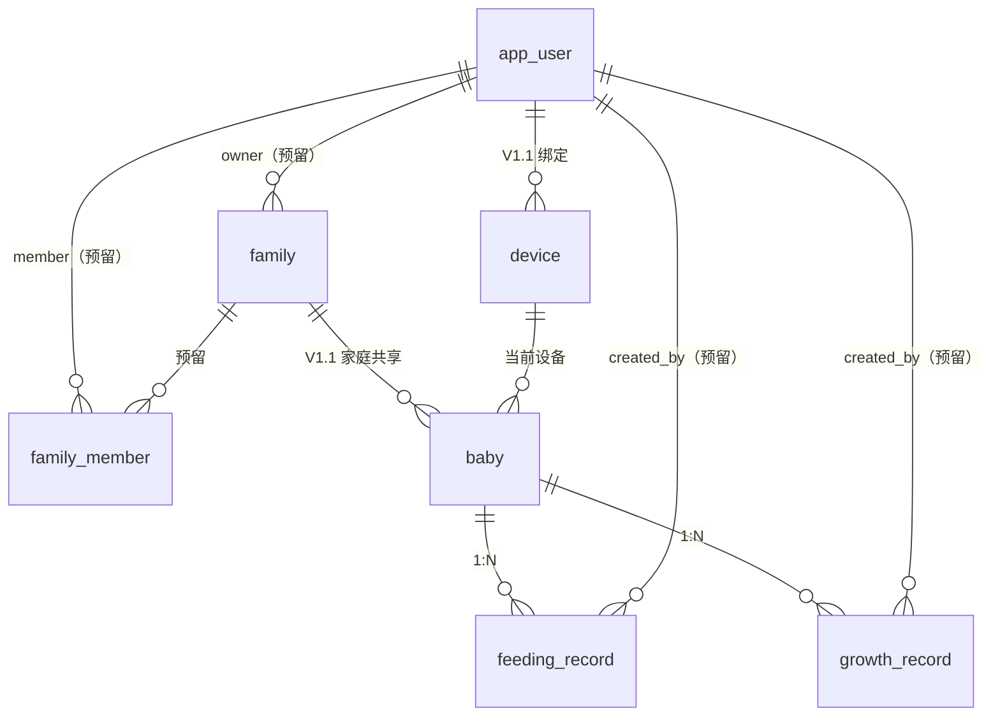

# 婴儿喂养 App V1.0 技术方案（定稿）

- 文档版本：v1.0-final
- 作者：architect
- 日期：2026-10-26
- 目标仓库：`F:\AI\claude-work\project\zz`
- 落库路径：`docs/architecture/v1.0-baby-feeding.md`
- 适用版本：PRD V1.0；V1.1 仅做扩展点预留，不实现
- 边界语义补充：`docs/architecture/v1.0-contract-addendum.md`（Q-01 ~ Q-18，与本文冲突时以其为准）

> **用户已确认的评审决议（覆盖下文所有冲突表述）**
>
> 1. 版本范围：仅 V1.0；V1.1/V1.2 不做。
> 2. 身份：匿名设备 UUID；最多 5 个宝宝；弱网离线仅保证页面已加载后；V1.0 不做账号注销/彻底删除。
> 3. 数据加密：**仅 HTTPS 传输加密 + 生产磁盘加密，不做应用层字段加密**。下文所有 AES-GCM、`*_enc`、`CryptoService`、`APP_CRYPTO_KEY`、AAD、密钥轮换、加密落库测试的表述均作废。数据库列按下表使用明文普通列。
> 4. 仍保留：设备 ID 的 HMAC-SHA256 摘要（单向哈希）；CSV 导出 token 的 HMAC 签名。
>
> | 原字段                                                                   | 定稿字段                                             | 类型                              |
> | --------------------------------------------------------------------- | ------------------------------------------------ | ------------------------------- |
> | `baby.name_enc`                                                       | `baby.name`                                      | `VARCHAR(40)`                   |
> | `feeding_record.breast_side_enc`                                      | `breast_side`                                    | `VARCHAR(8)`                    |
> | `feeding_record.amount_enc`                                           | `amount_value`                                   | `DECIMAL(8,2)`                  |
> | `feeding_record.duration_enc`                                         | `duration_sec`                                   | `INT UNSIGNED`                  |
> | `feeding_record.note_enc`                                             | `note`                                           | `VARCHAR(400)`                  |
> | `feeding_record.tags_enc`                                             | `tags`                                           | `JSON`                          |
> | `growth_record.height_enc/weight_enc/head_circumference_enc/note_enc` | `height_cm/weight_kg/head_circumference_cm/note` | `DECIMAL(5,2)` / `VARCHAR(400)` |
> | `app_user.phone_enc`                                                  | `app_user.phone`                                 | `VARCHAR(32)`                   |
> | `family.name_enc`                                                     | `family.name`                                    | `VARCHAR(40)`                   |

---

## 0. 结论摘要（先看这一节）

1. **范围**：只做 PRD V1.0 的快速喂养记录、基础统计、生长数据录入/自身趋势、CSV 导出、宝宝档案；分龄指导、家庭协同、提醒、AI 不做。
2. **技术栈**：前端 Vue 3 + Vite 5 + TypeScript + Pinia + Vue Router + Vant 4 + ECharts 5 + axios；后端 Spring Boot 3.3.5 + Java 21 + Gradle 8.7 + MyBatis-Plus 3.5.7 + Flyway 10 + MySQL 8.0.27 + Redis 5（Lettuce）。
3. **持久层明确结论：选 MyBatis-Plus，不选 Spring Data JPA**。理由：本项目的核心 SQL 是“按设备/宝宝/本地日期做区间查询、按 revision 做条件更新、批量软删除”，用显式 SQL 更可控；业务字段为明文，Service 负责校验与统计；避免 Hibernate 懒加载/N+1/脏检查在移动端低配 API 上的不确定性。代价是要自己写分页与条件更新，但本项目表少、SQL 简单，利大于弊。
4. **身份**：匿名设备 UUID，无登录。后端只存 `HMAC-SHA256(APP_DEVICE_PEPPER, deviceId)` 的 32 字节摘要，不存原始设备 ID；请求头 `X-Device-Id`。V1.1 账号升级通过 `device.user_id` + `app_user` 预留。
5. **离线同步**：客户端生成 UUID 主键 + `baseRevision` 乐观并发；服务端以 revision 为唯一裁决依据，不依赖客户端时钟；批量接口按条返回结果，允许部分成功；软删除即 tombstone。
6. **数据存储加密口径（用户已确认）**：V1.0 仅使用 **HTTPS 传输加密 + 生产环境磁盘加密**，**不做应用层字段加密**；数据库业务列均为明文普通列。设备原始 ID 仍只存 HMAC-SHA256 摘要；CSV 导出 token 仍用独立密钥 HMAC 签名。
7. **CSV 导出**：后端签发 5 分钟有效的 HMAC 下载 token，前端用浏览器导航下载（微信/iOS WebView 兼容性优于 blob 下载），CSV 带 UTF-8 BOM，并做公式注入转义。
8. **Redis 用途**：设备/宝宝归属缓存、统计缓存（版本号失效）、限流、同步分布式锁 + 批次幂等。没有“为了用而用”的 key；Redis 故障时除导出外均可降级。
9. **本机环境实测发现 3 个必须处理的偏差**：
   - `JAVA_HOME=C:\Program Files\Java\jdk1.8.0_281`，而 PATH 上的 `java` 是 21；Gradle 8.7 默认会跑在 JDK 8 上，Spring Boot 3 构建会失败。**所有 Gradle 命令必须显式 `JAVA_HOME=C:\Program Files\Java\jdk-21.0.12.1`**。
   - 系统 MySQL 客户端默认配置文件里有 `server-id=1`，直接运行 `mysql` 会报 unknown variable；脚本统一用 `mysql --no-defaults`。
   - Redis 实际为 **5.0.14.1**，不是 6/7；禁止使用 `GETDEL`、`SET ... GET`、`EXPIRE NX`、RedisJSON 等新命令。
10. **仓库准备**：`zz-fe`、`zz-be` worktree 仍停在 `49fe6a8 Initial commit`，没有 `CLAUDE.md`、`.claude/`、`scripts/`、`docs/`。必须先由 Lead 把骨架和本方案提交到 master，再让两个 worktree `merge master`，否则开发 agent 看不到契约。

---

## 1. 范围与边界

### 1.1 V1.0 做

| 模块     | 内容                                              |
| ------ | ----------------------------------------------- |
| 宝宝档案   | 昵称、性别、出生日期、默认宝宝、最多 5 个宝宝；CRUD；删除级联软删除其记录        |
| 快速喂养记录 | 母乳/配方奶/混合/辅食；母乳侧别；奶量/辅食量；计时；备注与预设标签；按日期回溯；编辑/删除 |
| 基础统计   | 日报（次数/分类/总奶量/总时长/单次时长）、趋势（按日，7/30 天，最多 90 天）    |
| 生长数据   | 身高/体重/头围录入、编辑、删除、列表、宝宝自身趋势（不接 WHO 百分位）          |
| CSV 导出 | 喂养记录按宝宝+日期范围导出，UTF-8 BOM，Excel 可打开              |
| 匿名身份   | 设备 UUID、设备初始化、按设备隔离                             |
| 离线     | 本地暂存、恢复后自动批量同步、冲突处理                             |

### 1.2 V1.0 明确不做

- 分龄喂养指导、黄疸/厌奶/辅食科普内容
- 家庭共享、多人协同、邀请
- 喂养间隔提醒、H5 推送
- AI 分析
- 注册登录、手机号、微信/支付宝授权
- WHO 百分位曲线、百分位定位、成长分析报告
- Excel/PDF/JSON 导出
- 对象存储、短信、外部 AI API、任何需要外部账号的云服务
- PWA/Service Worker 冷启动离线（弱网本地暂存只保证“应用已加载后”的离线记录；冷启动离线可作 V1.1 增强）
- 账号注销/数据彻底删除接口（合规上建议 V1.1 补，见风险）

### 1.3 V1.1 预留（只留结构与扩展点，不实现）

| 扩展点     | V1.0 预留                                                                             |
| ------- | ----------------------------------------------------------------------------------- |
| 账号升级    | `app_user` 表、`device.user_id`                                                       |
| 家庭协同    | `family`、`family_member` 表、`baby.family_id`、`created_by_user_id/updated_by_user_id` |
| 多端同步/拉取 | 所有业务表有 `revision`、`updated_at`、`deleted_at`（tombstone），可支持 `sync/pull`              |
| 提醒      | 不建表；V1.1 迁移新增 `reminder_rule`                                                       |
| 分龄指导    | 不建表；V1.1 迁移新增 `guidance_content`                                                    |
| AI      | 不建表；基于历史记录离线/服务端分析                                                                  |

---

## 2. 架构总览

### 2.1 组件职责

```
┌──────────────────────────────┐
│ Vue 3 H5 (Vite)              │
│ - 页面/交互/计时器            │
│ - Pinia 状态                  │
│ - IndexedDB 离线队列/缓存     │
│ - ECharts 图表                │
└──────────────┬───────────────┘
               │ HTTPS/JSON + X-Device-Id
               │ CSV 下载走一次性签名 URL
┌──────────────▼───────────────┐
│ Spring Boot 3.3.5 :8080      │
│ - REST /api/v1               │
│ - 设备解析/限流              │
│ - 业务校验/统计聚合          │
│ - 统计聚合（应用层）          │
│ - CSV 流式生成                │
│ - 同步批次/冲突裁决           │
└───────┬───────────────┬──────┘
        │               │
┌───────▼──────┐  ┌─────▼────────────┐
│ MySQL 8.0.27 │  │ Redis 5.0.14     │
│ 持久化/事务  │  │ 缓存/限流/锁     │
└──────────────┘  └──────────────────┘
```

- **前端不直接访问 MySQL/Redis**，只通过 REST。
- **后端不托管前端构建产物**：开发用 Vite dev server + proxy；集成/演示用 `vite preview` + preview proxy。原因是前后端分属两个 worktree，若让 Spring Boot 托管 `frontend/dist`，需要跨目录复制构建产物，容易在合并时产生构建耦合与文件冲突。生产部署时前端静态资源可由任意静态服务器/CDN 托管，后端只提供 API 与 CSV。CORS 仍按白名单配置，便于直连后端调试。
- **时钟**：服务端所有时间入库存 UTC；同时保存客户端时区偏移和“本地记录日期”，统计按本地日期分组。API 返回保留原始偏移的 ISO-8601 字符串，避免用户跨时区/跨午夜看到日期漂移。

### 2.2 本地运行拓扑

| 组件         | 地址                       | 说明                                                                  |
| ---------- | ------------------------ | ------------------------------------------------------------------- |
| MySQL      | `127.0.0.1:3306`         | 开发库 `zz_dev`，测试库 `zz_test`，E2E 库 `zz_e2e`；root/root123（仅本机，不写进提交文件） |
| Redis      | `127.0.0.1:6379`         | 开发 DB 0，测试 DB 15，E2E DB 14；密码 root123                               |
| 后端         | `http://127.0.0.1:8080`  | Spring Boot；API 前缀 `/api/v1`                                        |
| 前端 dev     | `http://127.0.0.1:5173`  | Vite dev server；`/api` proxy 到 8080                                 |
| 前端 preview | `http://127.0.0.1:4173`  | `vite preview`；同样配置 `/api` proxy，供 E2E/演示                           |
| CSV 下载     | 同源 `/api/v1/exports/...` | 通过代理或直连后端；token 在 URL 中，不依赖请求头                                      |

Vite 配置（两端一致）：

```ts
server: { port: 5173, proxy: { '/api': { target: 'http://127.0.0.1:8080', changeOrigin: true } } },
preview: { port: 4173, proxy: { '/api': { target: 'http://127.0.0.1:8080', changeOrigin: true } } }
```

CORS（直连 8080 时需要）：

- 允许源：`http://localhost:5173`、`http://127.0.0.1:5173`、`http://localhost:4173`、`http://127.0.0.1:4173`，由 `APP_CORS_ORIGINS` 覆盖。
- 允许头：`Content-Type, X-Device-Id, X-Request-Id, X-Client-Version`。
- 暴露头：`X-Request-Id, X-RateLimit-Limit, X-RateLimit-Remaining, Retry-After, Content-Disposition`。
- 不允许 credentials（无 Cookie）。
- 生产环境只允许正式 H5 域名。

### 2.3 后端分层

```
backend/src/main/java/com/zz/babyfeeding/
├── BabyFeedingApplication.java
├── common/
│   ├── api/          ApiResponse, PageResult, ErrorCode, BusinessException, GlobalExceptionHandler
│   ├── web/          RequestIdFilter, DeviceContextInterceptor, RateLimitInterceptor, CorsConfig, JacksonConfig, WebConfig
│   ├── security/     DeviceIdHasher(HMAC), ExportTokenService
│   ├── redis/        RedisKeys, RateLimiter, StatsCacheService, SyncLockService
│   └── util/         CsvUtils, TimeUtils, UuidUtils
├── device/           DeviceController, DeviceService, DeviceMapper, DeviceEntity, dto
├── baby/             BabyController, BabyService, BabyMapper, BabyEntity, dto
├── feeding/          FeedingController, FeedingService, FeedingMapper, FeedingEntity, dto, FeedingValidator
├── growth/           GrowthController, GrowthService, GrowthMapper, GrowthEntity, dto
├── stats/            StatsController, StatsService, dto
├── sync/             SyncController, SyncService, dto
├── export/           ExportController, ExportService, FeedingCsvWriter, dto
└── health/           HealthController
```

- Controller 只做参数绑定/响应包装；Service 负责事务、权限（设备归属）、校验与统计编排。
- Mapper 只做单表 SQL/条件更新；不把业务规则写在 XML。
- 跨表归属校验用 `(baby_id, device_id)` 复合外键兜底，Service 先查缓存再查库。

### 2.4 Redis 在 V1.0 的具体用途

统一前缀：`zz:bf:v1:`（测试环境再加 `test:` 前缀并使用 DB 15）。所有业务 key 必须带 TTL 或可被版本号淘汰；业务代码禁止 `KEYS`/`SCAN` 清理。

| 用途     | Key                                                                           | Value                               | TTL                | 失效/降级                                            |
| ------ | ----------------------------------------------------------------------------- | ----------------------------------- | ------------------ | ------------------------------------------------ |
| 设备缓存   | `dev:{deviceHashHex}`                                                         | JSON `{deviceId,status}`            | 30 min             | 设备禁用时 DEL；Redis 故障回源 DB                          |
| 宝宝归属缓存 | `baby:{deviceId}:{babyId}`                                                    | JSON `{revision,deleted,isDefault}` | 30 min             | 宝宝写操作后 DEL；Redis 故障回源 DB                         |
| 统计版本号  | `statsver:feed:{deviceId}:{babyId}`                                           | 自增整数                                | 7 d（每次 INCR 后重置）   | 喂养记录写操作成功后 INCR；统计缓存 key 带版本号，旧 key 自然过期         |
| 统计结果缓存 | `stats:feed:{deviceId}:{babyId}:{ver}:daily:{date}` / `...:trend:{from}:{to}` | JSON                                | 10 min             | 版本号变化即不再命中；Redis 故障直接查库                          |
| 限流     | `rl:{scope}:{subject}:{windowStart}`                                          | 计数                                  | 120 s（小时窗口 3700 s） | Lua `INCR`+`EXPIRE`；Redis 故障 fail-open 并告警日志     |
| 同步批次锁  | `lock:sync:{deviceId}`                                                        | batchId                             | 15 s（`SET NX PX`）  | 释放时 Lua compare-and-delete；Redis 故障跳过锁，靠 DB 幂等   |
| 同步批次幂等 | `sync:{deviceId}:{batchId}`                                                   | `{requestHash,responseJson,state}`  | 24 h               | 相同 batchId+相同请求体返回缓存响应；不同请求体 409；Redis 故障靠单条幂等兜底 |

限流额度（固定窗口，按设备/按 IP）：

| scope    | 维度     | 额度       | 说明                              |
| -------- | ------ | -------- | ------------------------------- |
| `api`    | device | 120 次/分钟 | 所有 `/api/v1/**`（健康检查、CSV 下载除外）  |
| `init`   | IP     | 10 次/小时  | `POST /devices/init`，防止刷设备      |
| `export` | device | 5 次/小时   | `POST /exports/feeding-records` |
| `sync`   | device | 30 次/分钟  | `POST /sync/push`               |

> Redis 5 兼容性：只使用 `SET NX PX`、`GET`、`DEL`、`INCR`、`EXPIRE`、`EVAL`、`MGET`。锁释放用 Lua 比较 value；不使用 Redisson（它依赖的新命令/脚本在本机 Redis 5 上风险更高），Lettuce 连接池足够。

### 2.5 安全与合规基线

- **传输**：生产强制 HTTPS；本地 HTTP 仅开发。
- **身份**：设备 UUID v4，122 bit 随机；服务端 HMAC 摘要存储，日志只打印摘要前 8 位。没有 token，也没有“越权枚举”之外的认证；通过限流 + 高熵 UUID + 不返回他人数据降低风险。设备 ID 丢失即数据丢失，这是匿名模式的固有限制，前端在档案页明确提示。
- **数据库**：只允许后端连接；账号最小权限（开发 root，生产单独账号）；生产启用磁盘加密（BitLocker/云盘加密）。
- **存储加密（用户已确认）**：不做应用层字段加密，数据库业务列为明文；以 HTTPS + 生产磁盘加密 + 数据库访问控制满足合规基线。详见 3.5。
- **日志**：不记录请求体、昵称、奶量、备注、设备原始 ID；只记录 requestId、设备摘要前缀、路由、状态码、耗时。
- **响应头**：`X-Content-Type-Options: nosniff`、`Referrer-Policy: no-referrer`、`Cache-Control: no-store`（API 与导出）。
- **CORS**：白名单，不开 credentials。
- **输入**：Bean Validation + 业务校验；MyBatis 参数绑定，不拼 SQL；JSON 未知字段忽略（便于 V1.1 加字段），但长度/枚举/范围严格校验。
- **CSV**：公式注入转义（`= + - @ \t \r` 开头加 `'`）、字段引号转义、UTF-8 BOM、`Content-Disposition` 只使用 ASCII 文件名。

---

## 3. 数据模型

### 3.1 ER 图




### 3.2 表结构

> 所有表 `ENGINE=InnoDB DEFAULT CHARSET=utf8mb4 COLLATE=utf8mb4_0900_ai_ci`；ID 列使用 `CHARACTER SET ascii COLLATE ascii_bin`。所有 `DATETIME(3)` 存 UTC。以下为契约级 DDL 摘要，完整索引/约束写入 `V1__init.sql`。

#### 3.2.1 `app_user`（V1.1 预留，V1.0 不写入）

| 字段                      | 类型              | 约束                            | 说明                   |
| ----------------------- | --------------- | ----------------------------- | -------------------- |
| id                      | BIGINT UNSIGNED | PK, AUTO_INCREMENT            | 内部主键                 |
| public_id               | CHAR(36) ASCII  | NOT NULL, UNIQUE              | 对外用户 UUID（未来）        |
| account_type            | VARCHAR(16)     | NOT NULL DEFAULT 'REGISTERED' | ANONYMOUS/REGISTERED |
| phone                   | VARCHAR(32)     | NULL                          | 未来手机号（V1.1，应用层不加密）   |
| status                  | VARCHAR(16)     | NOT NULL DEFAULT 'ACTIVE'     | ACTIVE/DISABLED      |
| created_at / updated_at | DATETIME(3)     | NOT NULL                      | 审计                   |

#### 3.2.2 `device`

| 字段                      | 类型              | 约束                        | 说明                            |
| ----------------------- | --------------- | ------------------------- | ----------------------------- |
| id                      | BIGINT UNSIGNED | PK, AUTO_INCREMENT        | 内部主键                          |
| device_uid_hash         | BINARY(32)      | NOT NULL, UNIQUE          | HMAC-SHA256(pepper, deviceId) |
| user_id                 | BIGINT UNSIGNED | NULL, FK app_user(id)     | V1.1 账号绑定                     |
| platform                | VARCHAR(16)     | NOT NULL DEFAULT 'H5'     | H5                            |
| app_version             | VARCHAR(32)     | NULL                      | 客户端版本                         |
| status                  | VARCHAR(16)     | NOT NULL DEFAULT 'ACTIVE' | ACTIVE/DISABLED               |
| first_seen_at           | DATETIME(3)     | NOT NULL                  | 首次初始化                         |
| last_seen_at            | DATETIME(3)     | NOT NULL                  | 初始化/写操作时更新（V1.0 不逐请求更新）       |
| created_at / updated_at | DATETIME(3)     | NOT NULL                  | 审计                            |

#### 3.2.3 `baby`

| 字段                                      | 类型              | 约束                         | 说明                          |
| --------------------------------------- | --------------- | -------------------------- | --------------------------- |
| id                                      | CHAR(36) ASCII  | PK                         | 客户端可生成 UUID                 |
| device_id                               | BIGINT UNSIGNED | NOT NULL, FK device(id)    | 设备隔离                        |
| name                                    | VARCHAR(40)     | NOT NULL                   | 宝宝昵称（1-20 个 Unicode 字符）     |
| gender                                  | VARCHAR(8)      | NOT NULL DEFAULT 'UNKNOWN' | MALE/FEMALE/UNKNOWN（明文，非敏感） |
| birth_date                              | DATE            | NOT NULL                   | 本地出生日期                      |
| is_default                              | TINYINT(1)      | NOT NULL DEFAULT 0         | 当前默认宝宝                      |
| family_id                               | CHAR(36) ASCII  | NULL, FK family(id)        | V1.1 预留                     |
| revision                                | INT UNSIGNED    | NOT NULL DEFAULT 1         | 乐观并发                        |
| deleted_at                              | DATETIME(3)     | NULL                       | 软删除                         |
| created_by_user_id / updated_by_user_id | BIGINT UNSIGNED | NULL, FK app_user(id)      | V1.1 预留                     |
| created_at / updated_at                 | DATETIME(3)     | NOT NULL                   | 审计                          |

索引/约束：

- `UNIQUE KEY uk_baby_id_device (id, device_id)`：给子表复合外键使用，同时保证设备归属。
- `KEY idx_baby_device (device_id, deleted_at, is_default)`。
- `KEY idx_baby_family (family_id)`。
- `is_default` 的唯一性由 Service 在事务内 `SELECT ... FOR UPDATE` 保证；MySQL 无部分唯一索引，不用生成列技巧，避免软删除/多宝宝边界复杂化。

#### 3.2.4 `feeding_record`

| 字段                                      | 类型              | 约束                 | 说明                                   |
| --------------------------------------- | --------------- | ------------------ | ------------------------------------ |
| id                                      | CHAR(36) ASCII  | PK                 | 客户端生成 UUID（离线幂等）                     |
| device_id                               | BIGINT UNSIGNED | NOT NULL           | 冗余归属，索引/隔离                           |
| baby_id                                 | CHAR(36) ASCII  | NOT NULL           | 宝宝                                   |
| feed_type                               | VARCHAR(16)     | NOT NULL           | BREAST/FORMULA/MIXED/SOLID（明文，统计过滤键） |
| breast_side                             | VARCHAR(8)      | NULL               | LEFT/RIGHT/BOTH                      |
| amount_value                            | DECIMAL(8,2)    | NULL               | 奶量/辅食量数值                             |
| amount_unit                             | VARCHAR(8)      | NULL               | ML/G（统计单位）                           |
| duration_sec                            | INT UNSIGNED    | NULL               | 喂养时长（秒）                              |
| note                                    | VARCHAR(400)    | NULL               | 备注（≤200 字符）                          |
| tags                                    | JSON            | NULL               | 标签数组（最多 5 个枚举）                       |
| started_at                              | DATETIME(3)     | NOT NULL           | UTC                                  |
| ended_at                                | DATETIME(3)     | NULL               | UTC；计时结束墙上时间                         |
| tz_offset_minutes                       | SMALLINT        | NOT NULL           | 客户端时区偏移，例如 +480                      |
| record_date                             | DATE            | NOT NULL           | 本地日期，由 started_at + offset 计算，统计分组键  |
| client_updated_at                       | DATETIME(3)     | NULL               | 客户端时间，仅诊断，不参与冲突裁决                    |
| revision                                | INT UNSIGNED    | NOT NULL DEFAULT 1 | 乐观并发                                 |
| deleted_at                              | DATETIME(3)     | NULL               | tombstone                            |
| created_by_user_id / updated_by_user_id | BIGINT UNSIGNED | NULL               | V1.1 预留                              |
| created_at / updated_at                 | DATETIME(3)     | NOT NULL           | 审计                                   |

索引/约束：

- `KEY idx_feed_baby_date (device_id, baby_id, record_date, started_at)`：按日回溯、区间统计。
- `KEY idx_feed_device_date (device_id, record_date)`：设备级校验/导出。
- `KEY idx_feed_baby_started (baby_id, started_at)`。
- `CONSTRAINT fk_feed_baby_device FOREIGN KEY (baby_id, device_id) REFERENCES baby(id, device_id) ON DELETE RESTRICT`：从数据库层杜绝跨设备引用。
- `duration_sec` 与 `ended_at` 可同时存在：计时暂停时活跃时长 ≤ 墙上时长；统计使用 `duration_sec`。

#### 3.2.5 `growth_record`

| 字段                                      | 类型              | 约束                 | 说明          |
| --------------------------------------- | --------------- | ------------------ | ----------- |
| id                                      | CHAR(36) ASCII  | PK                 | 客户端生成 UUID  |
| device_id                               | BIGINT UNSIGNED | NOT NULL           | 归属          |
| baby_id                                 | CHAR(36) ASCII  | NOT NULL           | 宝宝          |
| measured_on                             | DATE            | NOT NULL           | 本地测量日期      |
| height_cm                               | DECIMAL(5,2)    | NULL               | 身高（cm）      |
| weight_kg                               | DECIMAL(5,2)    | NULL               | 体重（kg）      |
| head_circumference_cm                   | DECIMAL(5,2)    | NULL               | 头围（cm）      |
| note                                    | VARCHAR(400)    | NULL               | 备注（≤200 字符） |
| revision                                | INT UNSIGNED    | NOT NULL DEFAULT 1 | 乐观并发        |
| deleted_at                              | DATETIME(3)     | NULL               | tombstone   |
| created_by_user_id / updated_by_user_id | BIGINT UNSIGNED | NULL               | V1.1 预留     |
| created_at / updated_at                 | DATETIME(3)     | NOT NULL           | 审计          |

索引/约束：

- `KEY idx_growth_baby_date (device_id, baby_id, measured_on, created_at)`。
- `CONSTRAINT fk_growth_baby_device FOREIGN KEY (baby_id, device_id) REFERENCES baby(id, device_id) ON DELETE RESTRICT`。
- 同一天允许多条（例如早晚各测一次）；展示按 `measured_on DESC, created_at DESC`。

#### 3.2.6 `family` / `family_member`（V1.1 预留，V1.0 空表、无接口）

`family`：`id CHAR(36) PK`、`name VARCHAR(40)`、`owner_user_id BIGINT UNSIGNED NULL FK app_user(id)`、`created_at/updated_at`。

`family_member`：`family_id CHAR(36)`、`user_id BIGINT UNSIGNED`、`role VARCHAR(16)`（OWNER/CAREGIVER）、`status VARCHAR(16)`、`joined_at DATETIME(3)`、`created_at`；`PRIMARY KEY(family_id,user_id)`，外键到 `family/app_user`。

> 评审说明：这两张表 V1.0 不写、不读、不暴露接口，只为 V1.1 家庭协同减少迁移风险。若评审认为“空表即过度设计”，可把两张表移到 V1.1 迁移，但 `baby.family_id` 也需同步后移；推荐保留。

### 3.3 枚举

| 枚举             | 值                                                             | 标签/说明                  |
| -------------- | ------------------------------------------------------------- | ---------------------- |
| FeedingType    | `BREAST` / `FORMULA` / `MIXED` / `SOLID`                      | 母乳 / 配方奶 / 混合 / 辅食     |
| BreastSide     | `LEFT` / `RIGHT` / `BOTH`                                     | 左侧 / 右侧 / 双侧           |
| AmountUnit     | `ML` / `G`                                                    | 毫升 / 克                 |
| FeedingTag     | `SPIT_UP` / `REFUSED` / `SLEEPY` / `HICCUP` / `OTHER`         | 吐奶 / 拒食 / 困倦 / 打嗝 / 其他 |
| Gender         | `MALE` / `FEMALE` / `UNKNOWN`                                 | 男 / 女 / 未知             |
| DeviceStatus   | `ACTIVE` / `DISABLED`                                         | 正常 / 禁用                |
| SyncEntityType | `BABY` / `FEEDING_RECORD` / `GROWTH_RECORD`                   | 同步实体                   |
| SyncOp         | `UPSERT` / `DELETE`                                           | 同步操作                   |
| SyncItemStatus | `APPLIED` / `DUPLICATE` / `CONFLICT_SERVER_WINS` / `REJECTED` | 单条同步结果                 |

前端标签只用于展示；接口只传 code。

> 快捷记录交互与 PRD 对齐：**FAB 点击始终先打开计时弹窗**（默认类型 BREAST，预填上次侧别），弹窗顶部提供四类切换；切到 FORMULA/SOLID 时弹窗变为奶量键盘，MIXED 为“计时 + 奶量”。这样满足 PRD“点击悬浮按钮直接弹出计时弹窗”，同时保留快速切换。3 秒验收口径：从点击 FAB 到本地落库/成功提示 ≤3 秒，**不含实际喂养计时时长**；母乳场景从点击“结束”到保存 ≤1 秒。

### 3.4 时间、时区、软删除、审计

- **存储**：`started_at`/`ended_at`/`created_at`/`updated_at`/`deleted_at` 均为 UTC `DATETIME(3)`。JVM 默认时区设为 UTC；MySQL 连接串 `connectionTimeZone=UTC&forceConnectionTimeZoneToSession=true`，避免 `SYSTEM` 时区导致隐式转换。
- **请求**：`startedAt`/`endedAt` 必须是带偏移的 ISO-8601，例如 `2026-10-26T14:00:00+08:00`；拒绝无偏移的本地时间。后端解析为 `OffsetDateTime`，存 UTC，同时存 `tz_offset_minutes`。
- **本地日期**：`record_date = startedAt.atZoneSameInstant(offset).toLocalDate()`；服务端计算，客户端不传。这样跨午夜、跨时区、夏令时都由偏移决定，统计与“按日期回溯”一致。
- **响应**：时间字段用原始偏移回写，例如 `2026-10-26T14:00:00+08:00`；前端不需要重新推断历史时区。`createdAt/updatedAt/deletedAt` 用 UTC `Z`。
- **日期参数**：`date`/`from`/`to` 为 `YYYY-MM-DD` 的“记录本地日期”，不是服务器 UTC 日期。
- **软删除**：业务表用 `deleted_at`，不物理删除；列表默认过滤，按 id 查询可返回 tombstone（供同步/冲突解析）；删除幂等。宝宝删除级联软删除其喂养/生长记录，并递增 revision。
- **审计**：`created_at`/`updated_at` 由应用写入 UTC；V1.0 `created_by_user_id/updated_by_user_id` 为 NULL；V1.1 账号/家庭上线后回填。

### 3.5 数据存储与加密口径（用户已确认）

- V1.0 **不做应用层字段加密**。`baby.name`、`feeding_record.*`、`growth_record.*` 等业务列为明文普通列，便于索引、统计、导出与排障。
- 合规措施：生产环境强制 HTTPS；数据库磁盘加密（BitLocker/云盘加密）；数据库账号最小权限；备份加密；日志不记录昵称、奶量、备注、原始设备 ID 等敏感字段。
- 设备身份：服务端只存 `HMAC-SHA256(APP_DEVICE_PEPPER, deviceId)`，不存原始设备 UUID；pepper 只从环境变量读取。
- 导出 token：`HMAC-SHA256(APP_EXPORT_TOKEN_KEY, payload)`，与设备 pepper 分离；TTL 300 秒。
- 密钥管理：`APP_DEVICE_PEPPER`、`APP_EXPORT_TOKEN_KEY` 只从环境变量/密钥文件读取，缺失即启动失败；`.env.example` 只放占位符。V1.0 不引入 `APP_CRYPTO_KEY`、AES-GCM、AAD 或密钥轮换。
- 合规取舍：PRD 字面“所有喂养数据全程加密存储”由传输层与磁盘层满足；若后续审计要求应用层加密，需回到 architect 变更数据模型、统计与导出实现。

---

## 4. 接口契约

### 4.1 通用规范

- Base URL：`/api/v1`。
- 编码：UTF-8；请求/响应 `application/json`（CSV 除外）。
- 设备头：`X-Device-Id: <uuid>`，所有 `/api/v1/**` 必须携带，例外：
  - `GET /api/v1/health`
  - `GET /api/v1/exports/feeding-records/{token}.csv`（能力 token 代替设备头）
- 可选头：`X-Request-Id`（UUID，缺省服务端生成并回写）、`X-Client-Version`（如 `1.0.0`）。
- ID：UUID v4 小写字符串；宝宝/喂养/生长记录允许客户端生成，服务端不强制替换（保证离线幂等）。
- 时间：ISO-8601 带偏移（记录时间）或 `YYYY-MM-DD`（本地日期）；响应时间保留原始偏移，审计时间用 UTC `Z`。
- 金额/测量值：JSON number，最多 1 位小数（体重 2 位）；服务端按 BigDecimal 校验，不接受字符串。
- 未知 JSON 字段：忽略（向前兼容 V1.1）；缺失必填字段/非法枚举/越界 → 400。
- 请求体上限 1 MB；同步批次最多 50 条。
- 成功统一 HTTP 200（创建也返回 200，用 `created` 标志区分），减少前端分支。

#### 成功响应包

```json
{
  "code": "OK",
  "message": "success",
  "data": {},
  "requestId": "4f1c2f7e-9d1a-4b7c-9c2e-3f6a1b2c3d4e",
  "serverTime": "2026-10-26T08:00:00.000Z"
}
```

#### 错误响应包

```json
{
  "code": "VALIDATION_ERROR",
  "message": "请求参数校验失败",
  "data": {
    "fieldErrors": [
      { "field": "amountValue", "message": "配方奶量必须大于 0 且不超过 500 ml" }
    ]
  },
  "requestId": "4f1c2f7e-9d1a-4b7c-9c2e-3f6a1b2c3d4e",
  "serverTime": "2026-10-26T08:00:00.000Z"
}
```

- `data` 可为 `null`；错误时放上下文（字段错误、当前 revision、行数限制等）。
- 生产环境不返回堆栈。

### 4.2 错误码与 HTTP 状态

| code                     | HTTP | 场景                              |
| ------------------------ | ---- | ------------------------------- |
| `OK`                     | 200  | 成功                              |
| `VALIDATION_ERROR`       | 400  | 字段/业务规则校验失败                     |
| `BAD_REQUEST`            | 400  | JSON 解析失败、参数类型错误                |
| `DEVICE_ID_REQUIRED`     | 400  | 缺少 `X-Device-Id`                |
| `DEVICE_ID_INVALID`      | 400  | 非 UUID 格式                       |
| `DEVICE_NOT_REGISTERED`  | 409  | 设备未初始化；客户端应调 init 后重试           |
| `DEVICE_DISABLED`        | 403  | 设备被禁用                           |
| `NOT_FOUND`              | 404  | 资源不存在或不属于当前设备（不泄露存在性）           |
| `CONFLICT`               | 409  | `baseRevision` 与当前 revision 不一致 |
| `SYNC_IN_PROGRESS`       | 409  | 同一设备同步批次正在处理                    |
| `RATE_LIMITED`           | 429  | 超过限流；带 `Retry-After`            |
| `PAYLOAD_TOO_LARGE`      | 413  | 请求体/批次超限                        |
| `UNSUPPORTED_MEDIA_TYPE` | 415  | 非 JSON                          |
| `EXPORT_TOO_LARGE`       | 413  | 导出范围/行数超限                       |
| `EXPORT_TOKEN_INVALID`   | 403  | token 签名非法/格式错误                 |
| `EXPORT_TOKEN_EXPIRED`   | 410  | token 过期                        |
| `BABY_LIMIT_EXCEEDED`    | 400  | 超过 5 个宝宝                        |
| `DEFAULT_BABY_REQUIRED`  | 400  | 试图取消唯一默认宝宝                      |
| `INTERNAL_ERROR`         | 500  | 未预期异常                           |
| `SERVICE_UNAVAILABLE`    | 503  | DB/Redis 不可用（健康检查）              |

### 4.3 分页规范

- Query：`page`（1 起，默认 1）、`size`（默认 20，最大 100）。
- 响应：

```json
{
  "code": "OK",
  "message": "success",
  "data": {
    "items": [],
    "page": 1,
    "size": 20,
    "total": 42,
    "hasNext": true
  },
  "requestId": "...",
  "serverTime": "..."
}
```


- 固定排序：
  - 喂养记录：`started_at DESC, id DESC`。
  - 生长记录：`measured_on DESC, created_at DESC, id DESC`。
  - 宝宝列表：`is_default DESC, created_at ASC`（最多 5 个，不分页）。
- 不提供客户端自定义排序，避免索引失控。

### 4.4 设备初始化

#### `POST /api/v1/devices/init`

请求头：`X-Device-Id`。请求体：

```json
{ "platform": "H5", "appVersion": "1.0.0" }
```

响应：

```json
{
  "code": "OK",
  "message": "success",
  "data": {
    "deviceId": "5f0c2c1e-6a2b-4d3e-8f1a-2b3c4d5e6f70",
    "created": true,
    "firstSeenAt": "2026-10-26T08:00:00.000Z",
    "serverTime": "2026-10-26T08:00:00.000Z"
  },
  "requestId": "...",
  "serverTime": "2026-10-26T08:00:00.000Z"
}
```

规则：

- 幂等：同一设备重复调用返回 `created:false`，更新 `last_seen_at`/`app_version`。
- `platform` 仅允许 `H5`；`appVersion` 0-32 字符。
- 限流：10 次/小时/IP；超限 429。
- 未知设备调用其他业务接口 → 409 `DEVICE_NOT_REGISTERED`；前端自动 init 后重试一次。

### 4.5 宝宝档案

#### `GET /api/v1/babies`

响应 `data` 为数组（最多 5 个，不含已删除）：

```json
{
  "code": "OK",
  "message": "success",
  "data": [
    {
      "id": "b1a2c3d4-e5f6-4a7b-8c9d-0e1f2a3b4c5d",
      "name": "小满",
      "gender": "FEMALE",
      "birthDate": "2026-03-01",
      "isDefault": true,
      "revision": 1,
      "createdAt": "2026-10-26T08:00:00.000Z",
      "updatedAt": "2026-10-26T08:00:00.000Z",
      "deletedAt": null
    }
  ],
  "requestId": "...",
  "serverTime": "..."
}
```

#### `POST /api/v1/babies`

请求：

```json
{
  "id": "b1a2c3d4-e5f6-4a7b-8c9d-0e1f2a3b4c5d",
  "name": "小满",
  "gender": "FEMALE",
  "birthDate": "2026-03-01",
  "isDefault": true
}
```

响应：

```json
{
  "code": "OK",
  "message": "success",
  "data": {
    "created": true,
    "baby": {
      "id": "b1a2c3d4-e5f6-4a7b-8c9d-0e1f2a3b4c5d",
      "name": "小满",
      "gender": "FEMALE",
      "birthDate": "2026-03-01",
      "isDefault": true,
      "revision": 1,
      "createdAt": "2026-10-26T08:00:00.000Z",
      "updatedAt": "2026-10-26T08:00:00.000Z",
      "deletedAt": null
    }
  },
  "requestId": "...",
  "serverTime": "..."
}
```

校验：

- `id` 可选；缺省服务端生成；客户端传则必须是 UUID v4。
- `name` 去首尾空格后 1-20 个 Unicode 字符；不允许控制字符；明文存储。
- `gender` 默认 `UNKNOWN`。
- `birthDate` 不能晚于“今天”（按请求所在设备时区由客户端传的日期；服务端以 UTC 日期做上限，允许当天）；不能早于今天减 3 年。
- 设备最多 5 个宝宝；超限 `BABY_LIMIT_EXCEEDED`。
- 第一个宝宝自动成为默认；`isDefault:true` 会在同一事务内取消其他宝宝的默认标记。
- 相同 `id` 重复提交：返回 200 `created:false` 与已存在宝宝（幂等，不比较内容）。
- 跨设备 id：视为不存在（404），不泄露。

#### `GET /api/v1/babies/{babyId}`

- 属于当前设备且未删除 → 200；否则 404。
- 返回单个宝宝对象（同数组元素）。

#### `PATCH /api/v1/babies/{babyId}`

请求：

```json
{
  "baseRevision": 1,
  "name": "小满满",
  "gender": "FEMALE",
  "birthDate": "2026-03-01",
  "isDefault": true
}
```

- 只更新出现的字段；省略 = 不变；`null` 不允许用于必填字段。
- `baseRevision` 必填，必须等于当前 revision，否则 409 `CONFLICT`，`data.current` 返回服务端最新宝宝。
- 成功 revision+1。
- `isDefault:false`：若该宝宝是唯一/当前默认，返回 400 `DEFAULT_BABY_REQUIRED`；如需切换默认，对另一个宝宝传 `isDefault:true`。
- 修改出生日期会影响月龄展示，前端需提示。

#### `DELETE /api/v1/babies/{babyId}?baseRevision=1`

响应：

```json
{
  "code": "OK",
  "message": "success",
  "data": {
    "id": "b1a2c3d4-e5f6-4a7b-8c9d-0e1f2a3b4c5d",
    "revision": 2,
    "deletedAt": "2026-10-26T08:10:00.000Z",
    "cascadedFeedingRecords": 12,
    "cascadedGrowthRecords": 3,
    "alreadyDeleted": false
  },
  "requestId": "...",
  "serverTime": "..."
}
```

- 软删除宝宝，同时软删除其喂养/生长记录（递增各自 revision），保证统计/导出一致。
- 若删除的是默认宝宝，自动把最早创建的剩余宝宝设为默认；没有剩余则允许无默认。
- 已删除再次删除 → 200，`alreadyDeleted:true`（幂等）。
- `baseRevision` 不匹配 → 409。

### 4.6 喂养记录

#### 字段定义

| 字段              | 类型                      | 必填      | 说明                               |
| --------------- | ----------------------- | ------- | -------------------------------- |
| id              | string(UUID)            | POST 可选 | 客户端生成；幂等键                        |
| babyId          | string(UUID)            | 是       | 必须属于当前设备                         |
| feedType        | enum                    | 是       | BREAST/FORMULA/MIXED/SOLID       |
| breastSide      | enum/null               | 条件      | BREAST/MIXED 必填；其他必须 null        |
| amountValue     | number/null             | 条件      | 配方奶/混合必填；辅食可选；母乳必须 null          |
| amountUnit      | enum/null               | 条件      | 配方奶/混合=ML；辅食=G；母乳=null           |
| durationSec     | integer/null            | 条件      | 母乳/混合必填 1-21600；配方奶/辅食可选 0-21600 |
| startedAt       | string(offset ISO)      | 是       | 不晚于服务端当前时间 +5 分钟；不早于宝宝出生日期       |
| endedAt         | string(offset ISO)/null | 否       | ≥ startedAt；墙上时长 ≤6 小时           |
| note            | string/null             | 否       | ≤200 字符                          |
| tags            | string[]/null           | 否       | 最多 5 个，枚举去重                      |
| recordDate      | date                    | 响应      | 服务端由 startedAt+offset 计算         |
| tzOffsetMinutes | int                     | 响应      | 例如 480                           |
| revision        | int                     | 响应      | 乐观并发                             |
| deletedAt       | string/null             | 响应      | tombstone                        |

按类型的校验矩阵：

| 类型      | breastSide         | amountValue/Unit | durationSec |
| ------- | ------------------ | ---------------- | ----------- |
| BREAST  | 必填 LEFT/RIGHT/BOTH | 必须 null          | 必填 1-21600  |
| FORMULA | 必须 null            | 必填 >0 ≤500，ML    | 可选 0-21600  |
| MIXED   | 必填                 | 必填 >0 ≤500，ML    | 必填 1-21600  |
| SOLID   | 必须 null            | 可选 >0 ≤2000，G    | 可选 0-21600  |

#### `POST /api/v1/feeding-records`

请求：

```json
{
  "id": "8f14e45f-ceea-4e7a-9d7b-3c1e2f4a5b6c",
  "babyId": "b1a2c3d4-e5f6-4a7b-8c9d-0e1f2a3b4c5d",
  "feedType": "BREAST",
  "breastSide": "LEFT",
  "durationSec": 900,
  "startedAt": "2026-10-26T14:00:00+08:00",
  "endedAt": "2026-10-26T14:15:00+08:00",
  "note": "中途有点吐奶",
  "tags": ["SPIT_UP"]
}
```

响应：

```json
{
  "code": "OK",
  "message": "success",
  "data": {
    "created": true,
    "record": {
      "id": "8f14e45f-ceea-4e7a-9d7b-3c1e2f4a5b6c",
      "babyId": "b1a2c3d4-e5f6-4a7b-8c9d-0e1f2a3b4c5d",
      "feedType": "BREAST",
      "breastSide": "LEFT",
      "amountValue": null,
      "amountUnit": null,
      "durationSec": 900,
      "startedAt": "2026-10-26T14:00:00+08:00",
      "endedAt": "2026-10-26T14:15:00+08:00",
      "recordDate": "2026-10-26",
      "tzOffsetMinutes": 480,
      "note": "中途有点吐奶",
      "tags": ["SPIT_UP"],
      "revision": 1,
      "createdAt": "2026-10-26T06:15:02.000Z",
      "updatedAt": "2026-10-26T06:15:02.000Z",
      "deletedAt": null
    }
  },
  "requestId": "...",
  "serverTime": "..."
}
```

- 相同 id 重复 POST：返回 200 `created:false` + 已存在记录；若已删除也返回 tombstone（不复活）。
- 创建成功后：`INCR statsver`；宝宝归属缓存不需要失效。
- 错误：宝宝不存在/不属于设备 404；校验 400；设备未注册 409。

#### `GET /api/v1/feeding-records`

Query：

- `babyId` 必填。
- 日期二选一：
  - `date=2026-10-26`：单日本地日期；
  - `from=2026-10-01&to=2026-10-31`：闭区间，跨度 ≤92 天。
  - 两者同时出现或都缺省 → 400。
- `feedType` 可选。
- `page`/`size` 见分页。
- 只返回未删除记录；按 `startedAt DESC, id DESC`。

示例：

```
GET /api/v1/feeding-records?babyId=b1a2...&date=2026-10-26&page=1&size=20
```

响应 `data` 为分页对象，`items` 元素同单条记录。

#### `GET /api/v1/feeding-records/{id}`

- 返回单条（包括已删除 tombstone，便于同步冲突解析）。
- 不属于当前设备/不存在 → 404。

#### `PATCH /api/v1/feeding-records/{id}`

请求（部分更新；省略不变，`null` 清空可选字段）：

```json
{
  "baseRevision": 1,
  "durationSec": 960,
  "note": "已补喂 30ml",
  "amountValue": 30,
  "amountUnit": "ML"
}
```

- `baseRevision` 必填且等于当前 revision，否则 409 `CONFLICT`，`data.current` 返回服务端最新记录。
- 合并后按类型重新跑校验矩阵（例如把 BREAST 改成 FORMULA 时需同时清空 side、补 amount）。
- 不允许修改 `babyId`（要换宝宝请删后重建，避免跨宝宝统计错乱）。
- 成功 revision+1，INCR 统计版本。

#### `DELETE /api/v1/feeding-records/{id}?baseRevision=1`

响应：

```json
{
  "code": "OK",
  "message": "success",
  "data": {
    "id": "8f14e45f-ceea-4e7a-9d7b-3c1e2f4a5b6c",
    "revision": 2,
    "deletedAt": "2026-10-26T08:20:00.000Z",
    "alreadyDeleted": false
  },
  "requestId": "...",
  "serverTime": "..."
}
```

- 软删除；幂等（已删除返回 `alreadyDeleted:true`）。
- `baseRevision` 不匹配 → 409。

### 4.7 统计

#### `GET /api/v1/stats/daily?babyId={id}&date=2026-10-26`

响应：

```json
{
  "code": "OK",
  "message": "success",
  "data": {
    "babyId": "b1a2c3d4-e5f6-4a7b-8c9d-0e1f2a3b4c5d",
    "date": "2026-10-26",
    "feedingCount": 8,
    "byType": { "BREAST": 4, "FORMULA": 2, "MIXED": 1, "SOLID": 1 },
    "totalAmountMl": 420.0,
    "totalSolidG": 30.0,
    "totalBreastDurationSec": 5400,
    "totalDurationSec": 7200,
    "avgAmountMl": 105.0,
    "lastFeedingAt": "2026-10-26T20:30:00+08:00",
    "cached": false
  },
  "requestId": "...",
  "serverTime": "..."
}
```

规则：

- `feedingCount` 未删除记录数（含四类）。
- `totalAmountMl` = FORMULA/MIXED 的 ML 之和；`totalSolidG` = SOLID 的 G 之和。
- `totalDurationSec` 所有有 duration 的记录之和；`totalBreastDurationSec` 仅 BREAST/MIXED。
- `avgAmountMl` 有 amount 的 FORMULA/MIXED 平均值，1 位小数；无则 null。
- `lastFeedingAt` 当天最晚 startedAt，保留偏移；无则 null。
- 缺失数据返回 0 / null，不报错。
- 日期格式/宝宝归属/未来日期（允许，返回零）校验；缓存 10 分钟，key 带版本。

#### `GET /api/v1/stats/trend?babyId={id}&from=2026-10-01&to=2026-10-26`

- `from`/`to` 必填，闭区间，跨度 ≤90 天；`from ≤ to`。
- 按日补齐缺失日期（零值）。

响应：

```json
{
  "code": "OK",
  "message": "success",
  "data": {
    "babyId": "b1a2c3d4-e5f6-4a7b-8c9d-0e1f2a3b4c5d",
    "from": "2026-10-01",
    "to": "2026-10-03",
    "granularity": "DAY",
    "points": [
      {
        "date": "2026-10-01",
        "feedingCount": 7,
        "totalAmountMl": 380.0,
        "totalSolidG": 0.0,
        "totalBreastDurationSec": 3600,
        "totalDurationSec": 5400,
        "avgDurationSec": 771
      },
      {
        "date": "2026-10-02",
        "feedingCount": 0,
        "totalAmountMl": 0.0,
        "totalSolidG": 0.0,
        "totalBreastDurationSec": 0,
        "totalDurationSec": 0,
        "avgDurationSec": null
      },
      {
        "date": "2026-10-03",
        "feedingCount": 8,
        "totalAmountMl": 420.0,
        "totalSolidG": 30.0,
        "totalBreastDurationSec": 5400,
        "totalDurationSec": 7200,
        "avgDurationSec": 720
      }
    ],
    "cached": false
  },
  "requestId": "...",
  "serverTime": "..."
}
```

- 前端图表使用 `points`；只返回统计结果，不返回明细字段。
- `avgDurationSec` = `totalDurationSec / 当天有 duration 的记录数`，四舍五入到整数；没有带 duration 的记录时为 null。
- 缓存 key 带 `statsver`；喂养记录写操作后版本自增。

### 4.8 生长记录

#### `GET /api/v1/growth-records?babyId={id}&from=&to=&page=1&size=20`

- `from`/`to` 可选，闭区间，跨度 ≤366 天；只返回未删除。
- 响应分页对象，元素：

```json
{
  "id": "c2b3d4e5-f6a7-4b8c-9d0e-1f2a3b4c5d6e",
  "babyId": "b1a2c3d4-e5f6-4a7b-8c9d-0e1f2a3b4c5d",
  "measuredOn": "2026-10-20",
  "heightCm": 68.5,
  "weightKg": 8.12,
  "headCircumferenceCm": 43.0,
  "note": "社区体检",
  "revision": 1,
  "createdAt": "2026-10-20T02:00:00.000Z",
  "updatedAt": "2026-10-20T02:00:00.000Z",
  "deletedAt": null
}
```

#### `GET /api/v1/growth-records/latest?babyId={id}`


- 返回该宝宝最新一条（按 measuredOn DESC, createdAt DESC）；无记录时 `data:null`（不报 404）。

#### `POST /api/v1/growth-records`

```json
{
  "id": "c2b3d4e5-f6a7-4b8c-9d0e-1f2a3b4c5d6e",
  "babyId": "b1a2c3d4-e5f6-4a7b-8c9d-0e1f2a3b4c5d",
  "measuredOn": "2026-10-20",
  "heightCm": 68.5,
  "weightKg": 8.12,
  "headCircumferenceCm": 43.0,
  "note": "社区体检"
}
```

- 至少提供 heightCm/weightKg/headCircumferenceCm 之一。
- `measuredOn`：不晚于今天，不早于宝宝出生日期。
- 范围：身高 20-150 cm，体重 0.5-50 kg（2 位小数），头围 20-70 cm；备注 ≤200 字符。
- `id` 可选，重复 id 幂等返回 `created:false`。
- 同一天允许多条。

#### `PATCH /api/v1/growth-records/{id}` / `DELETE /api/v1/growth-records/{id}?baseRevision=`

- 与喂养记录相同的 `baseRevision` 乐观并发、部分更新、软删除、幂等规则。
- PATCH 后仍至少保留一个指标；`null` 可清空某个指标。

### 4.9 CSV 导出

采用“两步式 + 签名 URL”，避免在微信/iOS WebView 里用 blob 下载失败：

#### `POST /api/v1/exports/feeding-records`

请求：

```json
{
  "babyId": "b1a2c3d4-e5f6-4a7b-8c9d-0e1f2a3b4c5d",
  "from": "2026-10-01",
  "to": "2026-10-26"
}
```

响应：

```json
{
  "code": "OK",
  "message": "success",
  "data": {
    "downloadUrl": "/api/v1/exports/feeding-records/eyJ2IjoxLCJkIjoi..._signature.csv",
    "expiresAt": "2026-10-26T08:35:00.000Z",
    "rowCount": 42
  },
  "requestId": "...",
  "serverTime": "..."
}
```

规则：

- `babyId` 属于当前设备；`from ≤ to`；跨度 ≤366 天；预估行数 ≤10,000，否则 413 `EXPORT_TOO_LARGE`（`data:{rowCount,maxRows:10000}`）。
- `rowCount` 是签发时点统计；实际下载为下载时最新数据（只读）。
- 限流 5 次/小时/设备。
- token：`base64url(payload) + "." + base64url(HMAC-SHA256(APP_EXPORT_TOKEN_KEY, payloadPart))`；payload 含版本、设备摘要、babyId、from、to、过期时间、nonce；TTL 300 秒。
- 前端拿到后 `window.location.href = API_ORIGIN + downloadUrl` 或打开新窗口；微信内提示“若未开始下载，请在浏览器中打开/复制链接”。

#### `GET /api/v1/exports/feeding-records/{token}.csv`

- **不需要** `X-Device-Id`；token 即能力凭证。
- 校验签名/过期/宝宝存在；非法签名 403 `EXPORT_TOKEN_INVALID`，过期 410 `EXPORT_TOKEN_EXPIRED`，宝宝已删除 404。
- 成功响应头：

```
Content-Type: text/csv; charset=UTF-8
Content-Disposition: attachment; filename="feeding-records-2026-10-01-2026-10-26.csv"
Cache-Control: no-store
X-Content-Type-Options: nosniff
```

- 内容：UTF-8 BOM（`EF BB BF`）+ CRLF 行尾；列：

```
记录ID,宝宝昵称,喂养类型,开始时间,结束时间,喂养时长(秒),母乳侧别,奶量/辅食量,单位,备注,标签,记录日期
```

- 类型/侧别/标签输出中文标签；备注/昵称做 CSV 引号转义；任何以 `= + - @ \t \r` 开头的单元格前置 `'` 防公式注入。
- 流式写出，不把整表加载到内存；按 `started_at ASC` 排序便于医护阅读。
- 空结果也返回表头。

### 4.10 离线批量同步

#### `POST /api/v1/sync/push`

请求：

```json
{
  "batchId": "d3c4e5f6-a7b8-4c9d-0e1f-2a3b4c5d6e7f",
  "clientTime": "2026-10-26T16:00:00+08:00",
  "changes": [
    {
      "entityType": "BABY",
      "op": "UPSERT",
      "id": "b1a2c3d4-e5f6-4a7b-8c9d-0e1f2a3b4c5d",
      "baseRevision": 0,
      "data": {
        "name": "小满",
        "gender": "FEMALE",
        "birthDate": "2026-03-01",
        "isDefault": true
      }
    },
    {
      "entityType": "FEEDING_RECORD",
      "op": "UPSERT",
      "id": "8f14e45f-ceea-4e7a-9d7b-3c1e2f4a5b6c",
      "baseRevision": 0,
      "data": {
        "babyId": "b1a2c3d4-e5f6-4a7b-8c9d-0e1f2a3b4c5d",
        "feedType": "FORMULA",
        "amountValue": 120,
        "amountUnit": "ML",
        "startedAt": "2026-10-26T15:30:00+08:00",
        "note": null,
        "tags": []
      }
    },
    {
      "entityType": "GROWTH_RECORD",
      "op": "DELETE",
      "id": "c2b3d4e5-f6a7-4b8c-9d0e-1f2a3b4c5d6e",
      "baseRevision": 2
    }
  ]
}
```

响应：

```json
{
  "code": "OK",
  "message": "success",
  "data": {
    "batchId": "d3c4e5f6-a7b8-4c9d-0e1f-2a3b4c5d6e7f",
    "replayed": false,
    "processedAt": "2026-10-26T08:00:02.000Z",
    "results": [
      {
        "entityType": "BABY",
        "id": "b1a2c3d4-e5f6-4a7b-8c9d-0e1f2a3b4c5d",
        "status": "APPLIED",
        "revision": 1,
        "record": { "id": "b1a2c3d4-e5f6-4a7b-8c9d-0e1f2a3b4c5d", "name": "小满", "birthDate": "2026-03-01", "gender": "FEMALE", "isDefault": true, "revision": 1 }
      },
      {
        "entityType": "FEEDING_RECORD",
        "id": "8f14e45f-ceea-4e7a-9d7b-3c1e2f4a5b6c",
        "status": "APPLIED",
        "revision": 1,
        "record": { "id": "8f14e45f-ceea-4e7a-9d7b-3c1e2f4a5b6c", "feedType": "FORMULA", "amountValue": 120, "revision": 1 }
      },
      {
        "entityType": "GROWTH_RECORD",
        "id": "c2b3d4e5-f6a7-4b8c-9d0e-1f2a3b4c5d6e",
        "status": "CONFLICT_SERVER_WINS",
        "revision": 3,
        "record": { "id": "c2b3d4e5-f6a7-4b8c-9d0e-1f2a3b4c5d6e", "measuredOn": "2026-10-20", "revision": 3 }
      }
    ],
    "summary": { "applied": 2, "duplicate": 0, "conflict": 1, "rejected": 0 }
  },
  "requestId": "...",
  "serverTime": "..."
}
```

规则：

- `changes` 1-50 条；重复 `(entityType,id)` 在同一批次 → 400 `VALIDATION_ERROR`（客户端合并后再发）。
- 每条独立事务处理；单条失败不影响其他条。
- 认证/设备校验失败仍整批失败（设备未注册等）。
- 客户端应按 `BABY → FEEDING_RECORD/GROWTH_RECORD` 排序；服务端不重排。若喂养记录引用的宝宝尚未同步 → 该条 `REJECTED`。
- 批次级：先抢 `lock:sync:{deviceId}`（15s），拿不到 → 409 `SYNC_IN_PROGRESS` + `Retry-After: 1`。
- 幂等：Redis 记录 `batchId → {requestHash,response}` 24h；相同 batchId + 相同请求体 → 返回缓存，`replayed:true`；相同 batchId + 不同请求体 → 409 `CONFLICT`。
- Redis 不可用：跳过锁和缓存，逐条按 revision 幂等处理（仍安全，只是可能重复劳动）。

#### 冲突裁决（唯一规则，不看客户端时钟）

| 场景                                      | 结果                                      |
| --------------------------------------- | --------------------------------------- |
| UPSERT，`baseRevision=0`，服务端不存在          | insert，revision=1，`APPLIED`             |
| UPSERT，`baseRevision=0`，服务端已存在          | 不改服务端，返回当前记录，`DUPLICATE`                |
| UPSERT，`baseRevision>0` 且等于当前 revision  | 更新，revision+1，`APPLIED`                 |
| UPSERT，`baseRevision>0` 且不等于当前 revision | 不改服务端，返回当前记录，`CONFLICT_SERVER_WINS`     |
| DELETE，服务端不存在                           | `DUPLICATE`（幂等）                         |
| DELETE，`baseRevision` 等于当前 revision     | 软删除，revision+1，`APPLIED`                |
| DELETE，baseRevision 不匹配                 | 不改服务端，`CONFLICT_SERVER_WINS`            |
| 校验失败/宝宝不存在/跨设备                          | 不改服务端，`REJECTED` + `error.code/message` |

- 客户端收到 `APPLIED/DUPLICATE`：用返回记录更新本地 revision，移出 outbox。
- `CONFLICT_SERVER_WINS`：服务端覆盖本地，提示“该记录已在其他端更新”；移出 outbox。
- `REJECTED`：移出 outbox，本地保留记录并标记“同步失败”，允许用户修改后重新入队；4xx 不自动重试。
- 网络/5xx/429：保留 outbox，指数退避重试。

#### 客户端 ID 与幂等键

- 宝宝/喂养/生长记录 id 均由客户端生成 UUID v4；服务端以主键做幂等。
- `batchId` 每次“新尝试”生成新 UUID；同一批次的网络重试复用原 batchId，以命中服务端缓存。
- 不使用客户端时钟做冲突排序；`clientTime`/`clientUpdatedAt` 仅诊断。

### 4.11 健康检查

#### `GET /api/v1/health`

无需设备头。成功：

```json
{
  "code": "OK",
  "message": "success",
  "data": {
    "status": "UP",
    "checks": {
      "db": { "status": "UP", "latencyMs": 3 },
      "redis": { "status": "UP", "latencyMs": 1 }
    },
    "version": "1.0.0",
    "serverTime": "2026-10-26T08:00:00.000Z"
  },
  "requestId": "...",
  "serverTime": "2026-10-26T08:00:00.000Z"
}
```

- 任一依赖 DOWN → HTTP 503，`code:SERVICE_UNAVAILABLE`，`data.status:DOWN`，checks 带错误摘要（不含连接串/密码）。
- 不暴露 actuator 其他端点。

### 4.12 版本与 V1.1 扩展方式

- 所有接口在 `/api/v1` 下；响应 `Content-Type` 之外加 `X-API-Version: 1`。
- V1.1 只做**加法**：新增 `/families`、`/guidance`、`/reminders`、`/sync/pull`；现有响应只加字段，不改字段语义；客户端忽略未知字段。
- 出现破坏性变更才开 `/api/v2`；V1 至少保留一个大版本周期。
- 现有同步协议已包含 `revision/deletedAt`，V1.1 多端拉取可直接复用。

---

## 5. 前端设计

### 5.1 技术栈与版本建议

| 依赖                                                                                 | 版本                  | 用途                              |
| ---------------------------------------------------------------------------------- | ------------------- | ------------------------------- |
| vue                                                                                | `^3.5.x`            | 框架                              |
| vue-router                                                                         | `^4.4.x`            | 路由                              |
| pinia                                                                              | `^2.2.x`            | 状态                              |
| vant                                                                               | `^4.9.x`            | 移动端组件                           |
| echarts                                                                            | `^5.5.x`            | 图表（按需引入）                        |
| axios                                                                              | `^1.7.x`            | HTTP                            |
| idb                                                                                | `^8.0.x`            | IndexedDB 轻量封装（唯一新增运行时依赖，约 1KB） |
| vite                                                                               | `^5.4.x`            | 构建                              |
| typescript / vue-tsc                                                               | `^5.6.x` / `^2.1.x` | 类型                              |
| vitest / @vue/test-utils / jsdom / fake-indexeddb                                  | 最新兼容版               | 单元/组件测试                         |
| @playwright/test                                                                   | `^1.48.x`           | E2E（放在根 `tests/`，不进入前端包）        |
| eslint / @vitejs/plugin-vue / unplugin-vue-components / @vant/auto-import-resolver | 兼容版                 | 规范/按需引入                         |

- 不引入 UI 框架之外的 CSS 框架；不引入 dayjs/date-fns，日期工具用原生 `Intl`/`Date` + 自写 `date.ts`，减少体积。
- UUID 生成**不用** `crypto.randomUUID()`（iOS 14 不支持），用 `crypto.getRandomValues` 手写 v4；无 `crypto` 时用 `Math.random` 兜底并提示。

### 5.2 路由与页面/组件

| 路由                           | 页面             | 主要内容                                 |
| ---------------------------- | -------------- | ------------------------------------ |
| `/`                          | HomeView       | 宝宝卡（昵称/月龄/切换）、今日摘要、今日时间线、悬浮记录按钮、离线横幅 |
| `/records`                   | RecordsView    | 日期导航/日历、当日列表、编辑/删除、待同步标记             |
| `/stats`                     | StatsView      | 7/30 天切换、汇总卡、趋势图（次数/奶量/时长）           |
| `/growth`                    | GrowthView     | 最新身高/体重/头围、记录列表、新增/编辑、自身趋势图          |
| `/profile`                   | ProfileView    | 宝宝列表/新增/编辑/默认/删除、导出、同步状态、设备说明、版本     |
| `/baby/new`、`/baby/:id/edit` | BabyEditView   | 宝宝档案表单（也可用弹窗；路由便于深链）                 |
| `/onboarding`                | OnboardingView | 首次使用创建设备+宝宝；可跳过昵称（默认“宝宝”）            |

组件：

```
components/
├── layout/TabbarLayout.vue
├── baby/BabyCard.vue, BabySwitcher.vue, BabyForm.vue
├── record/QuickRecordFab.vue, FeedingTypeSheet.vue,
│          BreastTimerSheet.vue, FormulaSheet.vue,
│          MixedSheet.vue, SolidSheet.vue,
│          FeedingRecordItem.vue, FeedingTimeline.vue,
│          DailySummaryCard.vue, DateNavigator.vue
├── chart/TrendChart.vue, GrowthChart.vue
├── common/OfflineBanner.vue, EmptyState.vue, LoadingSkeleton.vue,
│          ConfirmSheet.vue, TagSelector.vue
```

组合式函数：

```
composables/
├── useBabyAge.ts        # 出生日期 → 月龄/天数（本地日期）
├── useFeedingRecorder.ts# 记录创建/编辑/删除的乐观更新
├── useOfflineSync.ts    # 在线事件、退避、批次推送
├── useChart.ts          # ECharts 按需注册/实例生命周期
└── useDevice.ts         # 设备 ID 生成/init/409 重试
```

### 5.3 Pinia + IndexedDB

**选型**：IndexedDB（`idb`）存离线队列与最近数据缓存；`localStorage` 只存设备 ID、当前宝宝 ID、UI 偏好、同步锁时间戳。原因：队列/记录是结构化数据、可能超过 localStorage 5MB、需要按宝宝/日期建索引。

IndexedDB 数据库 `zz-baby-feeding` v1：

| store            | keyPath                | 索引                                         | 内容                      |
| ---------------- | ---------------------- | ------------------------------------------ | ----------------------- |
| `outbox`         | `key`（`entityType:id`） | `nextRetryAt`, `createdAt`                 | 待同步变更；同一记录多次编辑折叠为一条     |
| `feedingRecords` | `id`                   | `byBabyDate (babyId,recordDate)`, `byBaby` | 最近 30 天缓存 + tombstone   |
| `growthRecords`  | `id`                   | `byBabyDate (babyId,measuredOn)`, `byBaby` | 最近 100 条缓存              |
| `babies`         | `id`                   | —                                          | 宝宝缓存（含 revision）        |
| `meta`           | `key`                  | —                                          | `lastSyncAt`、schema 版本等 |

Pinia stores：

- `deviceStore`：`deviceId`、`registered`、`init()`、`onDeviceNotRegistered()`。
- `babyStore`：`babies`、`activeBabyId`、`activeBaby`、`ageMonths`、CRUD、默认切换。
- `feedingStore`：`todayRecords`、`todaySummary`、`pendingCount`、`create/update/delete`、`loadDay/loadRange`。
- `statsStore`：`range`、`points`、`daily`、离线时由缓存计算。
- `growthStore`：`items`、`latest`、CRUD。
- `syncStore`：`online`、`syncing`、`pendingCount`、`lastError`、`conflicts`、`syncNow()`。
- `uiStore`：toast/loading/confirm 等轻量 UI 状态。

### 5.4 离线流程、重试与冲突

写入流程（关键路径，保证 3 秒）：


1. 表单校验通过 → 生成 UUID → 组装记录（`startedAt` 带本地偏移）→ 写入 IndexedDB 缓存 → 入 outbox（`baseRevision` 取本地记录 revision，新建为 0）→ 更新 Pinia → 关闭弹窗/提示成功。
2. 若在线，异步触发 `syncNow()`；**不阻塞 UI**。后端返回后更新本地 revision；失败进入退避。
3. 若离线/请求失败：记录已在本机，横幅显示“离线，待同步 N 条”。

读取流程：

1. 启动：读 localStorage 设备 ID → 读 IndexedDB 宝宝/今日记录，立即渲染 → 后台 `devices/init`（若未注册）→ 推送 outbox → 拉取最新数据。
2. 列表/统计请求失败：回退到缓存；统计用缓存记录按同一口径在本地计算（7/30 天）；页面标注“离线数据”。
3. 在线恢复：`online` 事件、`visibilitychange`、每 30 秒（仅当 pending>0）触发同步。

outbox 规则：

- 同一记录多次编辑：保留一条 UPSERT，`baseRevision` 保持第一次入队时的服务端 revision；payload 用最新值。
- 新建后未同步就删除：直接删除 outbox 项与本地缓存（无需通知服务端）。
- 已同步记录删除：入队 `DELETE`，本地立即隐藏。
- 批量：按 `BABY` 优先，再按 `createdAt`；每批 ≤50；循环直到队列空或失败。
- 重试：网络错误/5xx/429 → 指数退避 `1s, 2s, 5s, 15s, 60s, 5min`（±20% jitter）；4xx → 不重试，标记失败。
- 客户端单飞：内存 Promise + `navigator.locks`（可用时）或 localStorage 时间戳锁（20 秒）避免多标签同时推送；服务端锁/幂等是最终兜底。
- 冲突：`CONFLICT_SERVER_WINS` 用服务端记录覆盖本地并 toast；`REJECTED` 保留本地并标记“同步失败”，用户编辑后重新入队。
- 设备未注册：先 `POST /devices/init`，成功后再推；离线则继续排队。

### 5.5 性能目标与手段

| 指标 | 目标 | 手段 |
|---|---|---|
| 首屏 | ≤1.5s（本地 preview，Fast 4G/中端机近似） | 路由懒加载；Vant 按需引入；ECharts 仅在统计/生长路由动态 import；首页骨架屏；无 Web Font；系统字体 |
| 单次记录 | ≤3s（FAB → 保存成功） | 默认类型/侧别/上次奶量预填；计时器一键开始/结束；本地先保存；无页面跳转；表单弹层常驻/空闲预加载 |
| 接口响应 | 记录写 ≤200ms（本机） | 索引、单表写、统计缓存、Hikari 小池、无同步外部调用 |
| 包体 | 首屏 JS ≤200KB gzip；CSS ≤50KB gzip；ECharts 异步 chunk ≤250KB gzip | 构建预算脚本 `check-bundle-size.mjs` 解析 manifest，超限失败 |
| 图表 | 30 天点渲染 <100ms | ECharts canvas、按需模块、数据点上限 90、无动画或短动画 |

- 首次进入首页后 `requestIdleCallback` 预加载记录弹层代码；FAB 点击不等网络。
- 首页只请求“今日记录 + 今日统计”，并行；宝宝信息优先用缓存。
- ECharts 模块：`LineChart`、`BarChart`、`GridComponent`、`TooltipComponent`、`LegendComponent`、`CanvasRenderer`；不引入 `echarts` 全量包。
- Vant：`unplugin-vue-components` + `@vant/auto-import-resolver`，只打包使用的组件与样式。
- 不在首屏引入 `@playwright`/测试库；生产 sourcemap 关闭。

### 5.6 图表选型

- 库：ECharts 5（canvas）。
- 统计页：一张主图 + 指标 tab（次数/总奶量/总时长），折线图；7/30 天切换；空数据显示 EmptyState。
- 生长页：指标 tab（身高/体重/头围），折线 + 数据点；仅展示宝宝自身数据，不画 WHO 百分位（V1.1 增强）。
- 颜色/可访问性遵循项目 dataviz 规范（若后续有设计 token，以其为准）；移动端 tooltip 用点击触发，不依赖 hover。
- 组件卸载 `dispose`；`ResizeObserver` 自适应；页面隐藏时暂停动画。

### 5.7 兼容性

- 目标：微信/支付宝内置浏览器、iOS 14+ Safari、Android 10+ Chrome/WebView。
- 构建 target `es2018`；避免 `crypto.randomUUID`、`Array.prototype.at`、`structuredClone`、CSS `:has`、顶层 await 等 iOS 14 不支持特性。
- 安全区：`viewport-fit=cover` + `env(safe-area-inset-bottom)`；Tabbar/FAB 避让。
- 下载：使用签名 URL 导航；微信内提供“复制链接/在浏览器打开”兜底（Clipboard API 不可用时用 Vant 提示手动长按复制）。
- localStorage 可能被隐私模式禁用：读写 try/catch，失败时用内存设备 ID 并提示“关闭无痕模式以保留数据”。
- 不注册 Service Worker，避免微信缓存策略问题。

---

## 6. 工程质量与测试

### 6.1 后端依赖与版本

| 依赖 | 版本 | 说明 |
|---|---|---|
| Java | 21 | 本机 `C:\Program Files\Java\jdk-21.0.12.1`；Gradle 需显式 JAVA_HOME |
| Gradle | 8.7（wrapper 固定） | 本机已装；用 `gradle wrapper --gradle-version 8.7` 生成 wrapper |
| Spring Boot | 3.3.5 | `spring-boot-starter-web`、`validation`、`data-redis`、`test` |
| MyBatis-Plus | 3.5.7 | `mybatis-plus-spring-boot3-starter` |
| Flyway | Boot 管理（10.x） | `flyway-core` + `flyway-mysql` |
| MySQL Connector/J | Boot 管理（8.x） | runtime |
| Lombok | 1.18.34 | 实体/DTO 减样板；版本需支持 Java 21 |
| Jackson | Boot 管理 | JSON；`FAIL_ON_UNKNOWN_PROPERTIES=false`，时区 UTC |
| Lettuce | Boot 管理 | Redis 客户端（不用 Redisson） |
| JUnit 5 / AssertJ / Mockito | Boot 管理 | 测试 |
| JaCoCo | 0.8.12 | 覆盖率报告；目标整体行覆盖 ≥70%，validator/CSV/统计关键分支 100% |

- 不引入 Spring Security：V1.0 无登录，设备拦截器 + 限流 + 校验足够；避免无谓的过滤器链复杂度。
- 不引入 springdoc/actuator 全量暴露；健康检查自写，减少攻击面。

### 6.2 配置、迁移与密钥

`backend/src/main/resources/application.yml`（提交）：

```yaml
spring:
  application.name: baby-feeding
  datasource:
    url: ${DB_URL:jdbc:mysql://127.0.0.1:3306/zz_dev?createDatabaseIfNotExist=true&useUnicode=true&characterEncoding=utf8&connectionTimeZone=UTC&forceConnectionTimeZoneToSession=true}
    username: ${DB_USERNAME:root}
    password: ${DB_PASSWORD}
    hikari.maximum-pool-size: 10
  flyway:
    enabled: true
    locations: classpath:db/migration
    clean-disabled: true
  data.redis:
    host: ${REDIS_HOST:127.0.0.1}
    port: ${REDIS_PORT:6379}
    password: ${REDIS_PASSWORD}
    database: ${REDIS_DATABASE:0}
    timeout: 2s
  jackson:
    time-zone: UTC
    default-property-inclusion: non_null
server:
  port: ${SERVER_PORT:8080}
  compression.enabled: true
  error.include-stacktrace: never
app:
  device-pepper: ${APP_DEVICE_PEPPER}
  export-token-key: ${APP_EXPORT_TOKEN_KEY}
  cors-origins: ${APP_CORS_ORIGINS:http://localhost:5173,http://127.0.0.1:5173,http://localhost:4173,http://127.0.0.1:4173}
```

- 密码/密钥**不写默认值**；缺失时启动失败。`.env.example` 只放占位符与生成命令。
- 本地运行：`backend/run-local.sh`（backend-dev 创建）读取 `backend/.env.local`（gitignore），设置 `JAVA_HOME` 后 `./gradlew bootRun`。
- 测试：`application-test.yml` 指向 `zz_test`，Redis DB 15；测试专用 key 可放在 `src/test/resources/application-test.yml`（明确标注 test-only，不是生产密钥）。测试配置启动时断言 DB URL 含 `zz_test`、Redis database=15，否则拒绝启动。
- 迁移：
  - `V1__init.sql` 创建全部表/索引/外键。
  - 回滚：Flyway OSS 不支持 undo；额外提供 `src/main/resources/db/rollback/V1__init.down.sql`（手工执行，按外键反序 DROP），并在 README 说明。每个后续迁移同样提供手工 down 脚本。
  - 不写入任何业务种子数据；V1.1 指导内容另做。
- 生产：环境变量/密钥管理注入；数据库账号最小权限；`clean-disabled=true`。

### 6.3 测试策略（无 Docker）

#### 后端

- **单元测试**（不依赖 MySQL/Redis，`./gradlew test`）：
  - `FeedingValidator`：四类矩阵、边界值、时区/未来时间/出生日期。
  - 统计聚合：手工构造解密后的记录，验证次数/奶量/时长/均值/零填充。
  - CSV：BOM、引号、逗号、换行、公式注入、中文。
  - 导出 token：签名/过期/篡改。
  - 设备 HMAC、UUID 校验、分页边界。
- **集成测试**（`./gradlew integrationTest`，需要本机 MySQL/Redis）：
  - 启动前 Flyway 创建/迁移 `zz_test`；每个用例前清表（按外键顺序）并清 Redis DB 15。
  - MockMvc 黑盒调用：设备 init → 宝宝 CRUD → 喂养 CRUD → 统计 → 生长 → 导出 → 同步。
  - **设备隔离**：设备 A 不能读/改/删设备 B 的宝宝、记录；导出 token 只包含签发设备数据。
  - 时区边界：`2026-10-26T23:59:59+08:00` 与 `2026-10-26T00:00:00+08:00` 的 record_date；UTC 存储；跨月/跨年。
  - 并发：两个 PATCH 同一 `baseRevision` → 一个 200、一个 409。
  - 同步：部分成功、重复 batchId、冲突、tombstone、批次锁。
  - 限流：超过阈值 429 + `Retry-After`。
- **测试库隔离**：
  - `zz_test` 专用；`application-test.yml` 校验 URL；禁止指向 `zz_dev`。
  - Redis DB 15 专用；key 前缀 `test:`；测试基类 `FLUSHDB`（只对 DB 15）。
  - JUnit 不并行，避免相互清库。
  - 本机服务检查：3306/6379 可连；测试启动失败时输出明确 runbook。

命令：

```bash
export JAVA_HOME="/c/Program Files/Java/jdk-21.0.12.1"
export PATH="$JAVA_HOME/bin:$PATH"
export DB_PASSWORD=root123 REDIS_PASSWORD=root123
cd backend
./gradlew clean test integrationTest
```

#### 前端

- `vitest` + `@vue/test-utils` + `jsdom` + `fake-indexeddb`：
  - 日期工具（月龄、recordDate、偏移 ISO）。
  - outbox 折叠、退避、部分结果处理、冲突覆盖。
  - 组件：FAB/类型弹层、计时器开始/暂停/结束、表单校验、记录列表、空状态。
  - 图表组件用 mock ECharts 验证 props/生命周期。
  - Bundle 预算脚本。
- `vue-tsc --noEmit`、ESLint、`vite build` 必须通过。

命令：

```bash
cd frontend
npm ci
npm run typecheck
npm run lint
npm run test:unit
npm run build
node scripts/check-bundle-size.mjs
```

#### 端到端（Playwright，根 `tests/`）

- 使用本机已安装 Chrome（`channel: 'chrome'`），**不下载 Chromium**；若 Chrome 不可用，用 `channel: 'msedge'`（本机已装 Edge）。
- 每次测试新建 browser context → 新设备 UUID，天然隔离；后端用 `zz_e2e` + Redis DB 14，数据累积不影响断言。
- 场景：
  1. 首次打开：设备 init、创建宝宝、首页显示月龄。
  2. 母乳计时记录：FAB → 开始 → 结束 → 保存；断言首页出现记录；测量点击到成功 toast 的耗时 <3s（自动化环境）。
  3. 配方奶快速记录、混合、辅食、备注/标签。
  4. 记录页按日期回溯、编辑、删除。
  5. 统计页 7/30 天图表渲染（canvas 存在）。
  6. 生长数据新增/编辑/趋势。
  7. CSV 导出：POST → 导航下载 → 文件前三字节 `EF BB BF`、表头正确、含公式注入转义。
  8. 离线：`context.setOffline(true)` → 新建记录 → 出现待同步横幅 → 恢复网络 → 自动同步 → 后端可查。
  9. 冲突：同一记录用两个 context/设备？V1.0 单设备，用 API 直接改 revision 模拟他端写入 → 客户端推送冲突 → 服务端记录生效。
- 命令：

```bash
# 终端 A：后端
cd backend
export JAVA_HOME="/c/Program Files/Java/jdk-21.0.12.1"
export DB_PASSWORD=root123 REDIS_PASSWORD=root123
export DB_URL='jdbc:mysql://127.0.0.1:3306/zz_e2e?createDatabaseIfNotExist=true&useUnicode=true&characterEncoding=utf8&connectionTimeZone=UTC&forceConnectionTimeZoneToSession=true'
export REDIS_DATABASE=14
./gradlew bootRun

# 终端 B：前端 preview
cd frontend
npm run build
npm run preview -- --port 4173

# 终端 C：E2E
cd tests
npm ci
npx playwright test
```

#### 验收清单（摘要）

- [ ] 四类喂养记录均可创建/编辑/删除；按日期回溯正确；跨午夜记录归属正确。
- [ ] 母乳左右侧、配方奶量、混合计时+奶量、辅食量校验正确。
- [ ] 首页 3 秒内完成一次记录（真机/自动化双验证）。
- [ ] 统计日报/趋势与手工核算一致；缺失日期补零；缓存写后失效。
- [ ] 生长三项至少一项录入；自身趋势正确；无 WHO 曲线。
- [ ] CSV：BOM、Excel 打开中文不乱码、公式注入被转义、超限报错。
- [ ] 两设备数据完全隔离；设备未注册返回 409 并可自动 init。
- [ ] 离线创建/编辑/删除 → 恢复网络自动同步；冲突按服务端胜出。
- [ ] 日志无敏感数据；生产启用 HTTPS 与磁盘加密。
- [ ] 首屏预算达标；控制台无错误；iOS 14/Android 10/微信/支付宝手测通过。
- [ ] 后端 `test + integrationTest` 全绿；前端 typecheck/lint/unit/build 全绿；E2E 全绿。

---

## 7. 实施计划

### 7.1 任务卡

> 所有任务的目标文件范围均限定在各自 worktree 的子目录内；root 文档/`.gitignore`/README 由 Lead 维护，避免合并冲突。

#### Phase 0：仓库准备与契约落地（Lead）

| ID | 角色 | 目标文件范围 | 依赖 | 验收标准 |
|---|---|---|---|---|
| L-00 | Lead | 主工作区：`CLAUDE.md`、`.claude/**`、`scripts/**`、`README.md`、`docs/architecture/v1.0-baby-feeding.md`、根 `.gitignore` | 用户确认本方案 | 骨架与契约提交到 master；`git status` 干净；worktree 可见契约 |
| L-01 | Lead | 主工作区分支操作 | L-00 | `git -C ../zz-fe merge master`、`git -C ../zz-be merge master` 成功；创建 `feat/integration` |

#### Phase 1：后端（backend-dev，串行）

| ID | 目标文件范围（`zz-be/backend/**`） | 依赖 | 验收标准 |
|---|---|---|---|
| BE-01 基础设施 | `build.gradle`、`settings.gradle`、`gradlew*`、`gradle/wrapper/**`、`src/main/java/**/BabyFeedingApplication.java`、`config/**`、`health/**`、`src/main/resources/application*.yml`、`db/migration/V1__init.sql`、`db/rollback/V1__init.down.sql`、`backend/README.md`、`backend/.env.example`、`backend/.gitignore` | L-01 | JDK21 下 `./gradlew clean build` 通过；bootRun 起 8080；`/api/v1/health` UP；Flyway 建表；无密码/密钥入库 |
| BE-02 公共层 | `common/api/**`、`common/web/**`、`common/security/**`、`common/redis/**`、`common/util/**`、对应测试 | BE-01 | 统一响应/错误码/requestId；设备头缺失/非法/未注册错误正确；限流 429；设备 HMAC/导出 token 签名测试；CORS 预检 |
| BE-03 设备+宝宝 | `device/**`、`baby/**`、对应测试 | BE-02 | init 幂等；宝宝 CRUD、默认、最多 5 个、删除级联；跨设备 404；缓存失效 |
| BE-04 喂养记录 | `feeding/**`、对应测试 | BE-03 | 四类校验矩阵；日期回溯；revision 409；软删除幂等；时区边界；跨设备隔离 |
| BE-05 生长记录 | `growth/**`、对应测试 | BE-03 | CRUD、latest、至少一项指标、范围校验、软删除/revision |
| BE-06 统计 | `stats/**`、`common/redis/StatsCacheService`、测试 | BE-04 | 日报/趋势与夹具一致；补零；缓存命中/写后失效；90 天限制 |
| BE-07 批量同步 | `sync/**`、测试 | BE-04、BE-05 | 部分成功；重复 batchId 回放；锁；冲突裁决；50 条上限；宝宝优先顺序 |
| BE-08 CSV 导出 | `export/**`、测试 | BE-04 | 签名 token、过期/篡改；BOM；转义/公式注入；366 天/10k 限制；无设备头下载 |
| BE-09 加固与自测 | `backend/README.md`、`src/integrationTest/**`、配置（不改业务契约） | BE-01~08 | `./gradlew clean test integrationTest` 全绿；JaCoCo ≥70%；健康检查/日志/限流复核；runbook 完整 |


#### Phase 2：前端（frontend-dev，串行；与后端并行）

| ID | 目标文件范围（`zz-fe/frontend/**`） | 依赖 | 验收标准 |
|---|---|---|---|
| FE-01 脚手架 | `package.json`、`vite.config.ts`、`tsconfig*`、`index.html`、`src/main.ts`、`src/App.vue`、`src/router/**`、`src/api/client.ts`、`src/db/**`、`src/stores/device.ts`、`src/styles/**`、`.env.example`、`.gitignore`、`scripts/check-bundle-size.mjs` | L-01（契约） | dev/preview 可启动；代理生效；设备 UUID/init/409 重试；typecheck/lint/build/预算脚本通过 |
| FE-02 宝宝档案 | `src/views/OnboardingView.vue`、`BabyEditView.vue`、`ProfileView.vue`（宝宝部分）、`src/components/baby/**`、`src/stores/baby.ts`、`src/api/babies.ts`、测试 | FE-01 | 创建/编辑/默认/删除/最多 5 个；离线缓存；表单校验；宝宝切换 |
| FE-03 首页+快速记录 | `src/views/HomeView.vue`、`src/components/record/**`、`src/stores/feeding.ts`、`src/composables/useFeedingRecorder.ts`、`useBabyAge.ts`、`src/api/feeding.ts`、测试 | FE-02 | 四类记录；计时器；备注/标签；本地先保存；3 秒验收；今日时间线/摘要 |
| FE-04 记录页 | `src/views/RecordsView.vue`、`src/components/record/FeedingRecordItem.vue`、`DateNavigator.vue`、`src/api/feeding.ts`、测试 | FE-03 | 日期回溯；编辑/删除；待同步标记；空/错/加载态 |
| FE-05 统计页 | `src/views/StatsView.vue`、`src/components/chart/TrendChart.vue`、`src/composables/useChart.ts`、`src/stores/stats.ts`、`src/api/stats.ts`、测试 | FE-03 | 7/30 天；三指标；空态；ECharts 懒加载；离线缓存计算 |
| FE-06 生长页 | `src/views/GrowthView.vue`、`src/components/chart/GrowthChart.vue`、`src/stores/growth.ts`、`src/api/growth.ts`、测试 | FE-02 | CRUD；至少一项；趋势图；无百分位 |
| FE-07 档案/导出/离线 UI | `src/views/ProfileView.vue`（完整）、`src/components/common/OfflineBanner.vue`、`src/api/export.ts`、`src/stores/sync.ts`（UI 部分）、测试 | FE-02、FE-04 | 导出签名 URL 下载/复制链接；同步状态；设备丢失提示 |
| FE-08 离线同步 | `src/db/outbox.ts`、`src/composables/useOfflineSync.ts`、`src/stores/sync.ts`、`src/api/sync.ts`、测试 | FE-03、FE-04 | outbox 折叠；批量 ≤50；退避；部分结果；冲突/拒绝处理；online 触发 |
| FE-09 性能与兼容收尾 | `src/**`（优化）、`frontend/README.md`、预算脚本 | FE-01~08 | 首屏/包体预算；iOS 14/Android 10 兼容检查；无 console 错误；最终自测 |

#### Phase 3：测试（test-engineer，集成工作区）

| ID | 目标文件范围（主工作区 `tests/**`、`docs/tests/**`） | 依赖 | 验收标准 |
|---|---|---|---|
| TE-01 用例与骨架 | `docs/tests/v1.0.md`、`tests/package.json`、`playwright.config.ts` | L-00 | 用例可追溯到契约；覆盖 API/UI/离线/导出/隔离；命令可运行 |
| TE-02 API 契约测试 | `tests/api/**` | BE-09 | 设备/宝宝/喂养/统计/生长/导出/同步/限流/隔离全绿 |
| TE-03 E2E | `tests/e2e/**` | FE-09、BE-09 | 9 个核心场景全绿；离线/3 秒/CSV 下载 |
| TE-04 全量验收 | `docs/tests/v1.0-run.md`（结果/缺陷） | TE-02、TE-03、合并完成 | 单元/集成/E2E/lint/build 全绿；无 P0/P1；缺陷定位到模块 |
| TE-05 回归 | `docs/tests/v1.0-run.md` | 修复完成 | 复测通过 |

#### Phase 4：审查与发布

| ID | 角色 | 依赖 | 验收标准 |
|---|---|---|---|
| CR-01 | code-reviewer | TE-04 | 只读审查集成分支；安全/隔离/边界/可维护性；无阻断问题 |
| FIX-01 | frontend-dev / backend-dev | CR-01 或 TE-04 | 在各自 worktree 修复，重新提交；不改契约 |
| L-02 | Lead | CR-01 通过、用户确认 | 合并 `feat/integration` → master；打 tag `v1.0.0`；不自动 push |

### 7.2 并行/串行关系

- **可并行**：
  - 后端 BE-01→BE-09 串行链 vs 前端 FE-01→FE-09 串行链，两条链并行。
  - TE-01 与开发并行（基于契约写用例/骨架）。
  - 后端内部理论上 BE-04/BE-05 可并行，但只有一名 backend-dev，实际串行；先 BE-04 再 BE-05。
  - 前端 FE-05/FE-06 可在 FE-03 后独立，但只有一名 frontend-dev，实际串行。
- **必须串行**：
  - BE-01 → BE-02 → BE-03；BE-04/BE-05 依赖 BE-03；BE-06/BE-07/BE-08 依赖 BE-04（BE-07 还依赖 BE-05）。
  - FE-01 → FE-02 → FE-03 → FE-04/FE-08；FE-08 依赖 FE-03/FE-04。
  - 合并到集成分支 → 全量测试 → code review → 用户确认 → master。
- **建议顺序**：
  - 后端：BE-01, BE-02, BE-03, BE-04, BE-05, BE-06, BE-07, BE-08, BE-09。
  - 前端：FE-01, FE-02, FE-03, FE-04, FE-08, FE-05, FE-06, FE-07, FE-09。
  - 每个任务完成即小步提交，commit message 带任务 ID。

### 7.3 集成顺序与命令

#### 步骤 0：环境与仓库准备

```bash
# 0.1 环境变量（每个终端都要）
export JAVA_HOME="/c/Program Files/Java/jdk-21.0.12.1"
export PATH="$JAVA_HOME/bin:$PATH"
java -version          # 必须 21
gradle -version        # 应显示 JVM 21（因为 JAVA_HOME 已覆盖）

# 0.2 数据库/Redis 检查（密码仅本机环境变量）
MYSQL_PWD=root123 mysql --no-defaults -h127.0.0.1 -P3306 -uroot -e \
  "CREATE DATABASE IF NOT EXISTS zz_dev CHARACTER SET utf8mb4 COLLATE utf8mb4_0900_ai_ci;
   CREATE DATABASE IF NOT EXISTS zz_test CHARACTER SET utf8mb4 COLLATE utf8mb4_0900_ai_ci;
   CREATE DATABASE IF NOT EXISTS zz_e2e CHARACTER SET utf8mb4 COLLATE utf8mb4_0900_ai_ci;"
REDISCLI_AUTH=root123 redis-cli -h127.0.0.1 -p6379 -n 15 FLUSHDB
```

#### 步骤 1：契约与骨架进 master（用户确认后）

```bash
cd /f/AI/claude-work/project/zz
git add CLAUDE.md .claude scripts README.md docs
git commit -m "chore: bootstrap multi-agent workflow and v1.0 architecture"
```

#### 步骤 2：两个 worktree 同步 master

```bash
git -C ../zz-fe merge master
git -C ../zz-be merge master
```

#### 步骤 3：开发完成后创建集成分支并合并

```bash
cd /f/AI/claude-work/project/zz
git status                     # 必须干净
git switch -c feat/integration master
git merge --no-ff feat/backend -m "merge: backend v1.0"
git merge --no-ff feat/frontend -m "merge: frontend v1.0"
```

#### 步骤 4：全量测试

```bash
# 后端
cd backend
export JAVA_HOME="/c/Program Files/Java/jdk-21.0.12.1"
export DB_PASSWORD=root123 REDIS_PASSWORD=root123
./gradlew clean check

# 前端
cd ../frontend
npm ci
npm run typecheck
npm run lint
npm run test:unit
npm run build
node scripts/check-bundle-size.mjs

# E2E（按 6.3 启动后端/预览后）
cd ../tests
npm ci
npx playwright test
```

#### 步骤 5：code review 与修复回路

- code-reviewer 只读审查 `feat/integration`；缺陷按模块退回 frontend-dev/backend-dev。
- 开发 agent 在各自 worktree 修复并提交；集成工作区重新 `git merge --no-ff feat/backend` / `feat/frontend`，重跑测试。
- 不允许在集成分支直接改业务代码；测试代码/测试文档由 test-engineer 在集成分支维护。

#### 步骤 6：用户确认后合并 master（必须人工确认）

```bash
cd /f/AI/claude-work/project/zz
git switch master
git merge --no-ff feat/integration -m "release: baby feeding app v1.0.0"
git tag -a v1.0.0 -m "baby feeding app v1.0.0"
# 是否 push 由用户决定；不得自动 push
```

### 7.4 风险清单与规避

| # | 风险 | 等级 | 规避 |
|---|---|---|---|
| 1 | `JAVA_HOME` 指向 JDK 8，Gradle/Spring Boot 3 构建失败 | 高 | 所有命令显式 export JDK21；Gradle toolchain 21；README/runbook 首行提醒；CI 检查 `gradle -version` JVM |
| 2 | 本机 Redis 5.0.14 不支持新命令 | 中 | 只用 5.0 命令；Lettuce；集成测试在 5.0.14 上跑；禁止 Redisson |
| 3 | MySQL 客户端默认配置 `server-id=1` 报错 | 中 | 所有脚本 `mysql --no-defaults`；测试/运维 runbook 注明 |
| 4 | 匿名设备 ID 丢失/被伪造 | 高 | 高熵 UUID、HMAC 摘要存储、限流、日志脱敏；档案页提示清除浏览器数据会丢数据；V1.1 账号升级 |
| 5 | 应用层未加密字段（用户已确认） | 高 | 生产强制 HTTPS + 磁盘加密；数据库账号最小权限；架构文档记录取舍；若后续审计要求应用层加密，回到 architect 变更 |
| 6 | 离线冲突/重复记录 | 中 | revision 裁决、客户端 UUID 幂等、tombstone、批次锁；冲突服务端胜出并提示 |
| 7 | 时区/跨午夜/夏令时 | 中 | UTC + offset + record_date；边界用例；API 返回原始偏移 |
| 8 | 微信/iOS CSV 下载失败 | 中 | 签名 URL 导航下载 + 复制链接兜底；真机手测；不做 blob-only |
| 9 | 首屏/图表性能不达标 | 中 | 路由懒加载、Vant 按需、ECharts 异步、预算脚本、首屏请求并行、缓存 |
| 10 | 无 Docker 导致环境不一致 | 高 | 本机 MySQL/Redis 专用库/DB；测试 URL/DB 断言；统一 runbook；健康检查；E2E 独立库 |
| 11 | worktree 缺少契约/骨架导致各自为政 | 高 | 先提交 master 并 merge 到 fe/be；contract 只由 Lead/architect 改；接口变更回 architect |
| 12 | 合并冲突 | 中 | frontend/ 与 backend/ 目录不重叠；root 文件由 Lead 独占；集成分支只合并，不直接改业务代码 |
| 13 | MySQL `ONLY_FULL_GROUP_BY` | 低 | 统计在 Java 聚合，不写复杂 GROUP BY；必须分组时列全 |
| 14 | 统计数据量/解密性能 | 中 | 90 天/366 天/10k 行上限；Redis 缓存；V1.1 可加日聚合表 |
| 15 | iOS 14 不支持 `crypto.randomUUID` 等新 API | 中 | UUID 手写、构建 target es2018、兼容清单、真机手测 |
| 16 | 多标签同时同步 | 低 | 客户端锁 + 服务端设备锁/幂等；最终以服务端为准 |
| 17 | 导出 token 泄露 | 低 | 5 分钟 TTL、`Cache-Control: no-store`、限流、只含必要过滤条件；不在日志打印 token |
| 18 | Spring Boot 3.3.5 + MyBatis-Plus 3.5.7 兼容性 | 中 | BE-01 先做最小启动/CRUD 冒烟；锁版本；不随意升级 |
| 19 | Gradle wrapper 下载失败 | 低 | 本机已装 Gradle 8.7，可先 `gradle wrapper`；必要时直接用系统 Gradle；不阻塞 |
| 20 | 空表 `family/family_member` 被审查质疑 | 低 | 注释“V1.1 reserved”，代码不引用；评审可决定后移到 V1.1 |
| 21 | 冷启动离线不可用 | 中 | 明确 V1.0 只保证应用已加载后的弱网暂存；PWA 列为 V1.1；用户可接受则确认 |
| 22 | 账号注销/数据删除缺失 | 中 | 列为 V1.1 合规增强；V1.0 提供 CSV 导出作为数据可携带兜底 |

---

## 8. 环境实测记录（供执行 agent 参考）

| 项 | 实测 | 结论 |
|---|---|---|
| Java | `java -version` = 21.0.12.1；`JAVA_HOME` = `C:\Program Files\Java\jdk1.8.0_281` | 必须覆盖 JAVA_HOME；JDK21 路径 `C:\Program Files\Java\jdk-21.0.12.1` |
| Gradle | 8.7，`gradle -v` 显示 JVM 1.8.0_281 | 覆盖 JAVA_HOME 后确认 JVM 21 |
| Node/npm | Node 22.15.1 / npm 10.9.2 | 可用 |
| MySQL | 8.0.27，127.0.0.1:3306，root/root123；`sql_mode` 含 `ONLY_FULL_GROUP_BY`、`STRICT_TRANS_TABLES`；`time_zone=SYSTEM` | 连接串设 UTC；避免仅 MySQL 方言怪癖；客户端用 `--no-defaults` |
| Redis | 5.0.14.1，127.0.0.1:6379，root123；PONG | 只用 Redis 5 命令 |
| 浏览器 | Chrome、Edge 已安装 | Playwright 用 `channel: 'chrome'`，无需下载 Chromium |
| 端口 | 3306/6379 已监听；8080/5173/4173 未监听 | 端口可用 |
| worktree | `zz-fe`/`zz-be` 均在 `49fe6a8`，无骨架/契约 | Phase 0 必须先提交并 merge |
| npm 源 | `https://registry.npmmirror.com` | 依赖安装可用 |
| Git 远程 | `git@github.com:Alan666156/zz.git`；master 与 origin 同点 | 是否 push 由用户决定 |

---

## 9. 已确认决策

1. **加密口径（已确认）**：V1.0 仅 HTTPS 传输加密 + 生产磁盘加密，不做应用层字段加密；数据库业务列明文。
2. **多宝宝（已确认）**：最多 5 个，前端可切换；删除宝宝级联软删除其喂养/生长记录。
3. **宝宝删除（已确认）**：级联软删除，UI 二次确认。
4. **微信/iOS 导出（已确认）**：签名 URL 导航下载 + 复制链接兜底。
5. **冷启动离线（已确认）**：V1.0 只保证应用已加载后的弱网暂存；不引入 PWA/Service Worker，PWA 放 V1.1。
6. **账号注销/彻底删除（已确认）**：V1.0 不做；V1.1 补，V1.0 用 CSV 导出作为数据可携兜底。
7. **远程 push**：所有提交/合并默认只在本地；push 需用户明确指示。


---

## 10. 评审通过后的落地动作（给 Lead）

1. 把本文件内容落到 `docs/architecture/v1.0-baby-feeding.md`（可按评审意见修订）。
2. 提交骨架 + 契约到 master（L-00）。
3. `zz-fe`、`zz-be` 分别 `merge master`（L-01）。
4. 创建 `feat/integration`（L-01）。
5. 按第 7 节任务卡派发；每张卡都带 worktree 路径、文件范围、验收标准。
6. 任何接口变更必须回到 architect 更新契约，并通知前后端；禁止开发 agent 私自改接口。
